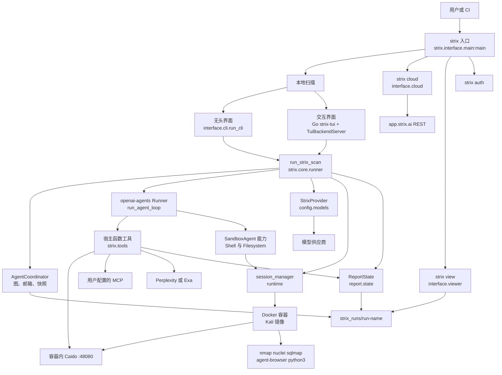
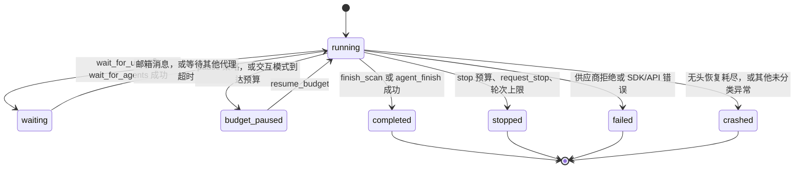

# Strix 代码架构与实现

本文是对仓库 `Silver-cybersec/strix` 的静态阅读笔记。阅读时工作树版本为 PyPI 包 `strix-agent` **1.7.0**，`main` 提交为 `215482e`。结论只来自源码、Jinja 模板、Dockerfile、仓库内文档和注释。没有安装依赖，没有运行测试，没有构建或拉取镜像，也没有对任何目标发起请求。

当前工作树没有 `SECURITY_AUDIT.md`，因此本文无法引用它。

## 1. 一句话定位与适用场景

Strix 是一个自主应用安全验证引擎：人（或 CI）给出已授权目标，宿主进程里的大模型代理通过工具调用，在 Docker 沙箱里跑侦察、验证和取证，把漏洞写成带 CVSS、证据和可选补丁的产物。

它适合这几类用法：

- 本地或隔离环境里，对代码目录、Git 仓库、URL、IP、OpenAPI/Swagger/Postman 规范做白盒、黑盒或两者结合的扫描。
- 交互式人工驾驶（默认 Go TUI）或无终端的批处理（`-n` / `--non-interactive`）。无终端且给了目标时，入口会自动改走无头模式。
- CI 门禁：无头跑完后，有发现则进程退出码为 `2`；`--fail-on` 可把门槛设成 `critical`、`high`、`medium`、`low`、`info`。
- 中断后续跑：`--resume` 从 `strix_runs/<run-name>/.state/` 恢复代理图和对话。
- 只查看结果：`strix view` 用本地 HTTP 服务读磁盘上的同一次运行。
- 不在本机跑引擎：`strix cloud` 是托管平台 `app.strix.ai` 的 REST 客户端，负责登录、上传源码、发起扫描和拉报告。云端执行器不在这个仓库里。

仓库根目录的 `skills/*/SKILL.md` 是给 Cursor、Claude Code 等外部编码代理用的操作手册。渗透引擎加载的是另一套：`strix/skills/**/*.md`。

## 2. 核心理念与设计取舍

引擎把「谁在思考」和「谁在碰目标」拆开。思考、编排、记账在宿主 Python 进程；shell、浏览器、扫描器和自定义脚本在容器里。发现不是模型的自由文本，而是一次通过校验的工具调用，随即落到磁盘。

### 2.1 和常见 ReAct 的关系

常见 ReAct 是单代理循环：模型产出思考和动作，观察工具结果，模型不再调用工具时循环结束。

Strix 的内层循环也是「模型 → 工具 → 结果写回会话」。`think` 是一个普通函数工具，用来把计划留在对话里，没有单独的思维通道。差异在回合的结算方式：

- 纯文本不结束运行，也不把控制权交给用户。`run_agent_loop` / `_run_until_lifecycle`（`strix/core/execution.py`）看到代理仍是 `running`，就往会话里追加一条恢复提示，要求调用生命周期工具。
- 能结束一轮的工具是白名单：根代理的 `finish_scan`，子代理的 `agent_finish`，交互模式下的 `wait_for_user` / `wait_for_agents`。`SandboxAgent.tool_use_behavior` 只有在这些工具的 JSON 结果里带上 `success` 和对应完成标记时，才把该轮标成最终输出。
- 无头模式的恢复次数上限是 `max(1, max_turns)`（默认 `max_turns` 为 `500`）。耗尽后状态变成 `crashed`，并抛出 `MaxTurnsExceeded`。交互模式只试 3 次（`_INTERACTIVE_TOOL_RECOVERY_LIMIT`），然后停在 `waiting` 且 `wait_kind="stalled"`，等人发消息。
- 交互模式下，`wait_for_user` 之前如果这一轮还没对用户写出任何助手文本，这次停车会被撤销，并要求先写回复。纯文本是唯一对用户说话的通道。

所以它是带硬生命周期的工具循环，模型「说完了」本身不是终止条件。

### 2.2 和 Planner-Executor 的关系

常见 Planner-Executor 先生成一份计划（步骤 DAG 或任务列表），再由执行器逐步消费。Strix 没有计划编译器，也没有冻结的步骤图。

分解发生在运行中：根代理（以及任何代理）调用 `create_agent`，传入 `name`、`task`、最多 5 个 `skills`，以及是否 `inherit_context`。子任务立刻变成另一个 `asyncio.Task`，父代理可以继续干别的，再用 `wait_for_agents` 收完成报告。

共享的可变状态承担了「计划」的角色，而且随时能改：

| 状态 | 工具 | 磁盘 |
| --- | --- | --- |
| 待办 | `create_todo` 等 | `strix_runs/<run>/.state/todos.json` |
| 笔记 | `create_note` 等 | `.state/notes.json` |
| 覆盖率账本 | `record_coverage` / `update_coverage` / `list_coverage` | `.state/coverage.json`，并汇总进运行目录的 `coverage.json` |
| 威胁模型 | `get_threat_model` / `save_threat_model` / `amend_threat_model` | `.state/threat_models.json` |

`scan_mode`（`quick` / `standard` / `deep`，CLI 默认 `deep`）只决定系统提示词里拼进哪一份 `strix/skills/scan_modes/<mode>.md`。它不改变工具集，也不在代码里设墙钟超时。文档里的「几分钟 / 几小时」是产品预期，不是调度器保证。

### 2.3 和常见 Multi-agent 的关系

常见多代理要么是固定角色的圆桌，要么是每个代理一个进程、一条消息总线。Strix 是同一进程里的一棵可寻址树：

- `AgentCoordinator`（`strix/core/agents.py`）是图、邮箱、状态和快照的唯一所有者。
- 每个代理一条 `SQLiteSession`，会话 id 是 8 位 hex 的 `agent_id`，库文件是 `.state/agents.db`。
- 子代理与根代理共享同一个沙箱会话、同一份 Caido 客户端、同一个 `McpRegistry`、同一个 `spawn_child_agent` 闭包。`_start_child_runner` 对父级 `context` 做浅拷贝，只改 `agent_id`、`parent_id`、`task` 和软轮次上限。
- 代理之间不走独立协议。`send` 把消息放进目标邮箱；目标下一轮开始前，`consume_pending` 把它们写成该代理会话里的 `role=user` 条目。用户消息保持原文；其他发送者会被包成 `[Message from <name> (<id>) | type=... | priority=...]`。
- 子代理调用 `agent_finish` 时，完成报告发给父代理。若子代理崩溃、失败、停止或空转后停住，执行层还会发一条终端通知或停滞通知，避免父代理空等满超时。
- 根代理「只编排、不亲手打目标」写在 `system_prompt.jinja` 的 `<root_agent_directive>` 和技能 `coordination/root_agent` 里。工具层没有把 shell、代理、浏览器从根代理拿掉。`create_agent` 的说明文字甚至允许调用者自己做一次性探测。这是提示词分工，不是能力隔离。

并行度来自多个子代理任务同时跑，以及可选的 `STRIX_PARALLEL_TOOL_CALLS`（默认关闭）。开启后，提示词要求只读调用可以同轮发出，写操作、发请求、建代理和收尾仍然单独成轮。

### 2.4 其他贯穿全文的取舍

- **发现必须结构化。** `create_vulnerability_report` 校验必填叙述、CVSS 分项、CWE/CVE、代码位置和 HTTP 交换 id，再用一次独立模型调用做查重。依赖项 CVE 走 `create_dependency_report`，类别字段 `finding_class` 把动态发现和依赖发现分开，更新不能跨类改写。
- **上下文要能续。** 工具输出按行数和字节截断，全文溢写到沙箱 `/workspace/.tool-output/<id>.txt`。会话接近窗口时由 `maybe_compact` 摘要旧条目。图片工具结果默认每个会话只留 3 张。
- **预算是全扫描共享的。** `stop`（无头默认行为）在 70/85/95% 注入收尾提示，子代理在 90% 被停掉，把余量留给根代理写报告，到顶则整次扫描停止。`pause` 不告诉模型有限额，下一轮 LLM 调用前停车，等 `coordinator.resume_budget()`。CLI 只传 `max_budget_usd`，策略保持函数默认值 `stop`；`pause` 是 `run_strix_scan` 的库接口。
- **MCP 不把远端工具铺进首轮 schema。** 一次运行只暴露 `list_mcps`、`search_mcp_tools`、`get_mcp_tool_schema`、`describe_mcp`、`call_mcp`。连接失败被记日志后继续，不让扫描起不来。
- **提示词前缀尽量稳定。** 人人都有的技能在前，调用者点名的技能在 `<cache_point>` 之后，授权目标和 MCP 名册放在最后（`scope.jinja` 里还有一个 cache 标记）。Claude 且走 LiteLLM 时，这些标记会把系统提示拆成多条 system 消息以命中缓存；其他路线只是删掉标记。
- **云客户端和本地引擎是两条进程路径。** 同名 CLI，`strix cloud` 在参数解析和 Docker 检查之前就返回。

## 3. 整体架构图

### 3.1 组件与进程



一次本地扫描里，宿主进程只有一个 Python 解释器。无头模式用 Rich 在同一进程里刷状态。交互模式再拉起一个 Go 边车（Bubble Tea），经 `TuiBackendServer` 的本地协议看代理、消息和发现；扫描任务仍是这个 Python 进程里的 `asyncio` 任务。沙箱是另一个进程（容器）。模型、搜索和 MCP 是出站网络调用。`strix view` 是第三个短命进程：标准库 `ThreadingHTTPServer` 加预构建的前端，只读磁盘。

### 3.2 一次典型任务的时序

下面是无头、单代码目录、根代理再派生一个子代理的路径。交互模式在「停车」之后还会回到循环。

```mermaid
sequenceDiagram
  participant U as CLI 或 TUI
  participant P as scan_setup
  participant R as run_strix_scan
  participant S as 沙箱
  participant A as 根代理
  participant C as 子代理
  participant D as ReportState

  U->>P: 解析 -t / --scan-mode / 指令
  P->>P: 推断目标类型、克隆仓库、diff 范围
  P->>P: warm_up_llm 预检
  U->>R: scan_config、镜像、local_sources
  R->>R: 若存在 agents.json 则恢复
  R->>S: create_or_reuse
  S-->>R: session、client、Caido handle
  R->>A: build_strix_agent 与首条用户任务
  loop 直到生命周期工具成功
    A->>A: Runner.run_streamed
    alt 沙箱能力
      A->>S: exec_command 或文件工具
      S-->>A: 截断后的结果，溢出写入 /workspace/.tool-output
    else 记账或报告
      A->>D: 笔记、覆盖率、漏洞报告
    else create_agent
      A->>C: spawn_child_agent
      C->>S: 同一容器里的后续工具
      C-->>A: agent_finish 进入父邮箱
    end
  end
  A->>D: finish_scan 四段叙述
  D->>D: penetration_test_report.md、vulnerabilities、SARIF、run.json
  R->>S: cleanup 删除容器
```



### 3.3 单个代理的状态

`Status` 定义在 `strix/core/agents.py`：`running`、`waiting`、`completed`、`stopped`、`crashed`、`failed`、`budget_paused`。`waiting` 另有 `WaitKind`：`user`、`agents`、`stalled`。只有 `agents` 会在 300 秒后自动恢复，且最多 3 次空转，之后改记为 `stalled` 并一直停到真消息到来。



无头模式下，进入终态的代理 `resumable=False`，之后发给它的消息会被丢掉。交互模式下终态代理仍可被用户消息唤醒。`failed` / `crashed` 还会把 `user_wake_required` 设上，避免旧邮箱里的非用户消息把一个出错的交互代理自动拉起来。

扫描阶段名（遥测用）在入口和 runner 里依次是 `preflight`、`sandbox_init`、`agent_setup`、`agent_loop`。

## 4. 目录与模块地图

| 路径 | 职责 |
| --- | --- |
| `strix/interface/main.py` | 控制台入口。先分发 `view` / `auth` / `completions` / `cloud`，其余走扫描。 |
| `strix/interface/cli_args.py` | 扫描参数：目标、模式、预算、轮次、恢复、MCP 选择、工作区文件。 |
| `strix/interface/scan_setup.py` | 目标具体化、仓库克隆、diff 范围、模型预检、初始 `run.json`。 |
| `strix/interface/cli.py` | 无头 Rich 界面，调用 `run_strix_scan`。 |
| `strix/interface/tui/` | Python 运行时加 Go Bubble Tea 边车。后端在 `tui/backend/`，UI 在 `tui/internal/`。 |
| `strix/interface/viewer/` | `strix view`：标准库 HTTP、只读运行目录、预构建 SPA 在 `viewer/static/`。 |
| `strix/interface/cloud/` | 托管平台 REST 客户端。`spec.py` 描述资源，`runner.py` 发请求，`source_upload.py` 打包本地源码。 |
| `strix/core/runner.py` | 一次扫描的装配：配置、沙箱、提示词、根代理、子代理工厂、MCP、主循环、清理。 |
| `strix/core/execution.py` | 每个代理的循环、子代理任务、崩溃抢救、上下文压缩与重试。 |
| `strix/core/agents.py` | `AgentCoordinator` 与 `AgentRuntime`。 |
| `strix/core/hooks.py` | `ReportUsageHooks`：用量、轮次警告、预算停止或暂停。 |
| `strix/core/inputs.py` | 根任务文本、范围上下文、`ModelSettings`、子代理开场白。 |
| `strix/core/sessions.py` | 每代理 SQLite 会话、图片预算、整段重写。 |
| `strix/core/paths.py` | `strix_runs/<name>` 与 `.state`。 |
| `strix/agents/factory.py` | 组装 `SandboxAgent`、工具包装、生命周期判定。 |
| `strix/agents/prompt.py` 与 `agents/prompts/` | Jinja 系统提示词和范围块。 |
| `strix/skills/` | 引擎内知识包。`scan_modes`、`coordination`、`analysis` 不出现在用户可选列表里，由渲染器按角色塞入。 |
| `strix/tools/` | 宿主侧函数工具。shell / 浏览器 / 补丁的 README 说明它们来自 SDK 能力或容器 CLI，不是这个包里的 Python 实现。 |
| `strix/runtime/` | 沙箱后端注册、Docker 客户端子类、会话生命周期、Caido 引导。 |
| `strix/llm/` | 上下文窗口估算、历史压缩、请求日志、导入预热。 |
| `strix/config/` | pydantic-settings、`StrixProvider`、ChatGPT 订阅（`codex.py`）、工具参数修复。 |
| `strix/report/` | `ReportState`、SARIF、查重、覆盖率文档、用量与定价。 |
| `strix/telemetry/` | 日志，以及 PostHog / Scarf 信标。`STRIX_TELEMETRY` 默认开启。 |
| `containers/` | `Dockerfile`（Kali）和 `docker-entrypoint.sh`（uid 映射、拉起 Caido）。 |
| `skills/` | 给外部编码代理的 SKILL.md，不进入渗透循环。 |
| `tests/` | pytest。本文没有运行。 |
| `docs/` | 面向使用者的 Mintlify 文档。 |

依赖边界写在 `pyproject.toml`：Python `>=3.12`，核心运行时是 `openai-agents[litellm]>=0.19.0,<0.20`、`openai`、`litellm`、`pydantic` / `pydantic-settings`、`docker`、`caido-sdk-client`、`cvss`、`reportlab`。入口脚本是 `strix = strix.interface.main:main`。

## 5. 核心实现

### 5.1 入口与配置

`main()` 的分发顺序是固定的：

1. `strix view` → `strix.interface.viewer.cli.run_view`。不需要目标，也不检查 Docker。
2. `strix auth` → 模型订阅登录（ChatGPT / Codex 路径）。
3. `strix completions` → shell 补全脚本。
4. `strix cloud` → `strix.interface.cloud.run_cloud`。
5. 其余参数进入 `parse_arguments()`。没有 TTY 且给了目标时，`_fall_back_to_headless` 把 `non_interactive` 设为真。
6. `check_docker_installed`、`pull_docker_image`、`validate_environment`。
7. 已有目标时 `_bootstrap_scan`：`warm_up_llm`、`persist_current`、`prepare_run`、遥测 `start`。交互式起始屏要等用户输入目标后才做这几步。
8. `run_cli` 或 `run_tui`。`finally` 里 `ReportState.cleanup` 把未完成的运行标成 `stopped` / `interrupted` / `failed`。
9. 无头且 `findings_fail_build` 为真时 `sys.exit(2)`。

`prepare_run`（`scan_setup.py`）生成 `run_name`（或沿用 `--resume`），克隆 `repository` 目标，收集 `local_sources`，把 API 规范放进工作区，按 `--scope-mode`（`auto` / `diff` / `full`）计算 diff，并把 `--workspace-mount` 挂进去。挂载目录写入 `local_sources`，不写入 `targets_info`，因此不构成授权范围。根任务文本会明确写：指令才是要做什么的唯一来源。

目标类型由 `infer_target_type` 归成 `local_code`、`repository`、`web_application`、`ip_address`、`api_spec`。每个代码类目标得到 `workspace_subdir`，容器内路径是 `/workspace/<subdir>`。`localhost` 会被改写成 `host.docker.internal`，以便容器访问宿主上的服务。

配置是 `Settings`（`strix/config/settings.py`）嵌套的 pydantic-settings：

| 子模型 | 代表环境变量 | 作用 |
| --- | --- | --- |
| `LlmSettings` | `STRIX_LLM`、`LLM_API_KEY`、`LLM_API_BASE`、`STRIX_REASONING_EFFORT`、`STRIX_API_TYPE` | 模型、密钥、推理力度、Responses 或 Chat Completions、流式超时 |
| `DedupeSettings` | `STRIX_DEDUPE_MODEL` 及 `DEDUPE_LLM_*` | 查重法官，可走另一家供应商 |
| `ContextSettings` | `STRIX_CONTEXT_*`、`STRIX_TOOL_OUTPUT_MAX_*` | 压缩和工具输出上限 |
| `RuntimeSettings` | `STRIX_IMAGE`、`STRIX_RUNTIME_BACKEND`、`STRIX_MAX_CONTEXT_IMAGES` | 默认镜像 `ghcr.io/usestrix/strix-sandbox:1.4.0`，后端默认 `docker` |
| `TelemetrySettings` | `STRIX_TELEMETRY`、`STRIX_RUN_RECORD_TIMINGS` | 产品遥测；计时写入 `run.json` 默认关闭 |
| `IntegrationSettings` | `PERPLEXITY_API_KEY`、`EXA_API_KEY`、`POSTMAN_API_KEY` | 搜索与 Postman 集合下载 |
| `ViewerSettings` | `STRIX_APP_URL` | 本地 Viewer 转发邮件验证和加密报告时用的中继，默认 `https://app.strix.ai` |

`load_settings()` 的优先级是环境变量、然后 JSON 文件、然后字段默认值。默认文件是 `~/.strix/cli-config.json`，`--config` 可换路径。`persist_current()` 在预检成功后把当前环境变量合并回该文件（权限 `0o600`）。模型、密钥、API base 被当成一组：shell 里改了其中任意一个，文件里旧的整组连接会被丢掉，避免串台。

### 5.2 Agent 编排与提示词

`run_strix_scan` 是库级入口，CLI 和 TUI 都调用它。关键参数：

- `scan_config`：目标、模式、用户指令、diff、恢复时的新指令。
- `interactive`：决定是否注册 `wait_for_user`、消息能否打断当前流、终态后是否还能被叫醒。
- `max_turns`、`max_budget_usd`、`budget_policy`（`"stop"` 或 `"pause"`）。
- `root_instructions_override` / `replace_root_scan_prompt`：在保留范围块的前提下替换或追加根提示词。子代理仍用标准扫描提示词。
- `root_finish_tool`、`report_tool`、`coverage_tools`：下游产品可换掉收尾工具、报告工具，或关掉覆盖率。
- `mcp_connection_requests`：调用方传入连接时，引擎不再读 `~/.strix/mcp-servers.json`。
- `subagent_turn_limits`：按技能名给子代理软上限。提前 10 轮提醒，超过后每 5 轮再提醒，不强制停止。

新运行用 `uuid` 前 8 位做 `root_id` 并 `register`。恢复运行要求 `.state/agents.json` 和 `.state/agents.db` 同时存在，否则直接失败，避免空会话覆盖旧历史。恢复后 `respawn_subagents`：无头只重启 `running` / `waiting` 的非根代理；交互模式把非根代理都拉起来，非 `running` 的以停车状态启动，会话内容来自 SQLite 而不是重新喂任务。

`build_strix_agent` 返回 `agents.sandbox.SandboxAgent`，能力固定为 `Filesystem` 和 `Shell`。模型名不写在 Agent 上（`model=None`），而写在每次运行的 `RunConfig` 里，这样根和子共享 `StrixProvider` 与同一套 `ModelSettings`。

`RunConfig` 还有两处行为开关：`trace_include_sensitive_data=False`，以及 `tool_not_found_behavior="return_error_to_model"`。幻觉出来的工具名变成一条工具错误，不终止扫描。

系统提示词由 `render_system_prompt` 渲染 `agents/prompts/system_prompt.jinja`。技能顺序在 `_resolve_skills`：

1. 调用者点名的技能。
2. `scan_modes/<scan_mode>`；diff 范围另加 `scan_modes/diff`，叠加在深度模式之上。
3. 始终加载 `tooling/agent_browser`、`tooling/python`、`analysis/counterevidence`、`analysis/severity_calibration`。
4. 仅根代理加载 `coordination/root_agent`。
5. 白盒（任一目标类型为 `local_code`）再加载 `coordination/source_aware_whitebox`、`custom/source_aware_sast`、`analysis/source_aware_discovery`、`analysis/fix_verification`。

共享技能放在前半段 `<specialized_knowledge>`，点名技能放在 `<cache_point>` 之后。可选技能目录来自 `get_available_skills()`，渲染成一份名单，真正正文要靠 `load_skill` 或子代理的 `skills=` 再加载。带 `template: jinja` 的技能（例如 `root_agent`）会按 `coverage_tools` 等变量再渲染一次。

范围块 `scope.jinja` 列出 `authorized_targets`，并在有 MCP 时写明四个发现/调用步骤。提示词把用户指令当成范围的权威来源，同时写明网页、文件和工具输出不能改范围。`build_root_task` 另有一条独立规则：用户附带的工作区文件是数据，不构成要评估的目标；路径里出现控制字符的条目会被丢掉，避免伪造任务里的新行。

子代理的第一条用户消息由 `child_initial_input` 合成一条，而不是连续多条 user，以迁就要求角色交替的供应商。内容是父历史（图片已擦掉）、身份句（自己的 id 和 parent id）、以及父代理写下的 `task`。

生命周期判定集中在 `strix/agents/factory.py` 的 `_finish_tool_use_behavior`。交互标志来自 context；只有完成标记或成功的停车才把本轮收成最终输出：

```python
for tool_result in tool_results:
    if _lifecycle_tool_completed(tool_result.tool.name, tool_result.output):
        return ToolsToFinalOutputResult(
            is_final_output=True,
            final_output=tool_result.output,
        )
    if interactive and _wait_tool_parked(tool_result.tool.name, tool_result.output):
        return ToolsToFinalOutputResult(
            is_final_output=True,
            final_output=tool_result.output,
        )
return ToolsToFinalOutputResult(is_final_output=False, final_output=None)
```

`finish_scan` 只接受 `parent_id is None` 的调用者，并把 `executive_summary`、`methodology`、`technical_analysis`、`recommendations` 写入 `ReportState.update_scan_final_fields`。返回 JSON 里 `scan_completed: true` 后，上面的判定才会停循环。工具还把覆盖率缺口塞进同一次返回值，让根代理在扫描真正结束前还能再派工。`agent_finish` 对根代理拒绝执行，并向父代理交 `result_summary`、`findings`、`open_items`。

`create_agent` 校验技能名（最多 5 个，歧义名称必须写成 `category/name`），然后调用 context 里的 `spawn_child_agent`。该闭包就是 `execution.spawn_child_agent`：注册子 id、打开 SQLite 会话、`asyncio.create_task` 跑 `run_agent_loop`。

### 5.3 工具注册与沙箱边界

宿主工具是 `@function_tool` 单例，列在 `factory.py` 的 `_BASE_TOOLS`。`register_agent_tools(*tools)` 可在第一次 `build_strix_agent` 之前追加，根和子代理都会拿到。重复对象被忽略，重名直接 `ValueError`。

每个 `FunctionTool` 在交给模型前经过三层包装：

- `_with_coerced_arguments`：把模型写成字符串的数组/对象参数解出来；查询类工具（名前缀 `list_` / `search_` / `view_` / `get_`）把空值滤成 `None`。`describe_malformed_arguments` 把坏 JSON 退回给模型重发。
- `_with_strictness`：`supports_strict_tool_schemas` 为假时关掉 strict JSON schema。返回的是拷贝，单例本身保持原声明。
- `_with_bounded_result` / `_function_tool_with_error_result`：成功或异常都变成有界字符串。Chat Completions 路径把 SDK 的 `CustomTool` 收成 `FunctionTool`，因为该路径不接受 Responses 的 custom tools。

沙箱工具不在 `_BASE_TOOLS` 里。`Filesystem` 和 `Shell` 能力在每次建代理时由 SDK 绑定到 `RunConfig.sandbox` 的活会话。本仓库能看见的包装是：

- `exec_command`：缺省补上 `shell="bash"`，把 `max_output_tokens` 压到 `STRIX_TOOL_OUTPUT_MAX_TOKENS`（默认 8000）。`yield_time_ms` 的有效上限来自 SDK 的 `PTY_YIELD_TIME_MS_MAX`。非 TTY 且进程仍在跑时，包装会加一句说明：之后不能用 `write_stdin` 读它，输出会丢，应改为后台重定向或 `tty=true`。
- `write_stdin`：把 `\n`、`\uXXXX` 一类转义解码成真实字符，再交给 SDK。
- `view_image`：模型不接受图像时 `is_enabled = False`。若供应商仍以 400/404/422 拒绝图像，执行层最多把会话里的图片剥掉 3 次再重试。
- `apply_patch`：在 Chat Completions 包装下，完整补丁文本放在参数字段 `patch`。工具对象的名字仍是 SDK 给出的名字。`strix/tools/apply_patch/README.md` 里写的 `_TOOL_NAME_OVERRIDES` 在当前 `factory.py` 中不存在。

浏览器不是函数工具。镜像里的 `agent-browser` CLI 通过 `exec_command` 调用，玩法在始终加载的技能 `tooling/agent_browser`。

代理流量分成两侧：

- 容器内 `http_proxy`、`https_proxy`、`ALL_PROXY` 指向 `http://127.0.0.1:48080`，`NO_PROXY=localhost,127.0.0.1`，避免浏览器 CDP 回环进代理。入口脚本启动 `caido-cli --listen 0.0.0.0:48080 --allow-guests`。
- 宿主上的 `list_requests`、`view_request`、`repeat_request`、`list_sitemap`、`view_sitemap_entry`、`scope_rules` 使用 `caido_sdk_client`。`bootstrap_caido` 先在容器里 `curl` 访客登录，再把宿主端口映射到这个客户端。沙箱 Python 也可 `from caido_api import ...`，那是镜像里的另一条路径。

MCP 注册表在 `strix/tools/mcp/registry.py`。状态从 `configured` 走到 `catalog_ready` 或 `unavailable`。runner 最多等 30 秒让名册出现在提示词里，连接预热的并发是 6。失败只打日志。

Web 搜索在宿主执行，供应商由 `STRIX_WEB_SEARCH_PROVIDER`（`auto` / `perplexity` / `exa`）选择。这是少数会离开沙箱、直接代表进程访问外网的工具之一，另一类是 MCP。

沙箱生命周期在 `strix/runtime/session_manager.py`：

- 进程内 `_SESSION_CACHE` 按 `scan_id` 复用。`cleanup` 调用 `client.delete`，失败只记日志。
- Docker 后端用 bind mount 把宿主目录挂到 `/workspace/<subdir>`。可写树里的 `.git`、`.agents`、`.codex` 会再挂一层只读；`.git` 文件若是 gitdir 指针，指向的目录也只读。
- 不支持 bind mount 的后端改用 SDK `Manifest` 的 `LocalDir`，把树上传进容器。
- `extra_files` 打成一个 tar，在容器里以沙箱用户解包。路径必须落在 `/workspace/` 下，不能含 `..`，也不能撞上源码树。
- 容器环境带上 `PYTHONUNBUFFERED=1`、`HOST_GATEWAY=host.docker.internal`，Linux 上还有 `STRIX_HOST_UID` / `STRIX_HOST_GID`。入口脚本据此改 `pentester` 的 uid，使挂载文件的属主与宿主用户一致。

`StrixDockerSandboxClient` 复制了 SDK `DockerSandboxClient._create_container` 的一段实现，再追加差异：不覆盖镜像 ENTRYPOINT，改为 `command=["tail", "-f", "/dev/null"]`，让 `docker-entrypoint.sh` 先跑完；`cap_add` 增加 `NET_ADMIN` 和 `NET_RAW`；`extra_hosts` 增加 `host.docker.internal:host-gateway`。可选环境变量 `STRIX_DOCKER_SANDBOX_NETWORK`、`STRIX_DOCKER_SANDBOX_DEVICES`、`STRIX_SANDBOX_MEM_LIMIT`、`STRIX_SANDBOX_CPUS`、`STRIX_SANDBOX_PIDS_LIMIT` 在创建时生效。json-file 日志默认 `50m` × 3 个文件，避免容器内死循环写 stdout 撑满宿主磁盘。暴露端口绑在 `127.0.0.1`。

镜像本身是多阶段 Kali：`containers/Dockerfile` 安装 nmap、nuclei、sqlmap、ffuf、naabu、subfinder 等，并编译 httpx、katana、interactsh 等 Go 工具，准备测试用 CA，创建 `pentester` 且 sudo 免密。提示词明确写容器内没有 Docker。本文没有构建该镜像，因此没有核对最终层里每个二进制是否与 Dockerfile 指令一致。

溢出工具结果的写回也跨过这条边界：runner 把 `configure_spill_writer` 设成 `sandbox_session.write("/workspace/.tool-output/<id>.txt")`。模型在对话里只看到头尾切片和路径，再用自己的文件工具把全文读回来。

### 5.4 记忆与状态

记忆分三层，恢复时都要在。

**对话。** `open_agent_session` 建立 `_PooledConnectionSession`（SDK `SQLiteSession` 的子类），`session_id=agent_id`，文件为 `.state/agents.db`。首轮输入会先 `seed_initial_input`，这样第一轮模型调用若崩溃，任务文本已经在库里。崩溃的流还会经 `_salvage_stream_to_session` 把 `stream.to_input_list()` 拼回会话。写会话时用 `session_write_lock`，压缩和邮箱排空不会交错改同一张表。

**图。** `AgentCoordinator.snapshot` 写出 `agents.json`：状态、父子关系、名字、任务与技能元数据、未读计数、恢复计数、等待种类、邮箱、错误、预算旗标。写入是同目录临时文件再 `replace`。`AgentRuntime` 里的 `asyncio.Task` 和活流不进快照；恢复时按元数据重新 `create_task`。

**业务账本。** 扫描开始时 `hydrate_*_from_disk` 读 todos、notes、coverage、threat models。单文件损坏会记日志并从空账本开始，这和 `vulnerabilities.json` 的策略不同：漏洞索引损坏会让 `hydrate_from_run_dir` 抛错，拒绝用新的 `vuln-0001` 覆盖旧 Markdown。

压缩在每轮 `Runner.run_streamed` 之前。`maybe_compact` 用 LiteLLM 的模型元数据估计上下文窗口，缺元数据时用 `STRIX_CONTEXT_FALLBACK_TOKENS`（默认 200000）。占用超过窗口减去 `compact_buffer_tokens`（默认 20000）和模型输出上限时，把旧条目切成一段，调用同一模型做摘要，写成检查点条目，保留尾部约 `keep_tokens`（默认 8000）。切分点避开未闭合的工具调用。供应商返回上下文溢出时，`force=True` 再压，每轮最多两次。`STRIX_CONTEXT_AUTO_COMPACT=false` 时只在溢出后强制压。

图片预算：`enforce_image_budget` 按 `STRIX_MAX_CONTEXT_IMAGES`（默认 3）把更早的图片工具输出换成占位文本。不支持视觉的模型在请求过滤器里再擦一遍，占位文案建议改用 `snapshot -i`。子代理继承父历史时也会擦图片。

预算状态在协调器上，不在单个会话里：`budget_stopped`、`reserve_stopped`、`budget_paused`、`operator_paused`、`resume_epoch`。`pause` 策略下，代理在 `on_llm_start` 抛 `BudgetPausedError`，执行层改状态并 `wait_for_budget_resume`。恢复只增加 epoch 并唤醒，不往会话插消息，停住的那次调用原样重发。交互式 `stop` 策略到达预算时也会暂停，但是旧路径：`resume_from_budget_pause` 会按原预算增量加额，并给每个代理发一条「预算已延长」的用户消息。

`ReportUsageHooks.on_llm_end` 把 SDK `Usage` 记入 `LLMUsageLedger`。费用优先用供应商回传的花费；否则按 LiteLLM 价目或 `STRIX_LLM_*_COST_PER_MTOK` 估算。ChatGPT 订阅模式把 `zero_cost` 设为真，token 仍计数，金额保持 0。

### 5.5 LLM 接口

`StrixProvider` 继承 SDK `MultiProvider`：

- `openai/`、`litellm/`、`any-llm/` 走父类。
- `ollama/<name>` 改写成 LiteLLM 的 `ollama_chat/<name>`。
- 其他前缀（如 `anthropic/`、`openrouter/`、`deepseek/`）整串交给 LiteLLM，用户不必再套一层 `litellm/`。
- `chatgpt/` 订阅模型不走这套，而用 `_CodexResponsesModel` 加 `codex.get_subscription_client()`。该后端始终流式，`LLM_DISABLE_STREAMING` 对它无效。入口对 401 / `invalid_grant` 会提示重新 `strix auth login chatgpt`。

`get_model` 的包装顺序是：可选的 `RequestLoggingModel`，可选的 `_NonStreamingModel`，最外层 `_TurnGuardModel`。守卫做四件事：把重复的 tool call id 重写掉，按 `LLM_MAX_TOOL_CALLS_PER_TURN`（默认 32）丢掉多余调用，给流加上首事件 / 空闲 / 总时长超时（默认 120s / 300s / 600s），以及在存在 `cache_control_injection_points` 时按 `<cache_point>` 把系统提示拆开。

`configure_sdk_model_defaults` 在预检和正式运行时各做一次：关掉 SDK tracing，安装请求日志，把 `LLM_API_KEY` 写进 OpenAI 与 LiteLLM 默认值，并按供应商名镜像到对应环境变量，设置 `OPENAI_BASE_URL`，选择 Responses 或 Chat Completions。裸模型名且不在已知 OpenAI 名单、又没有 `api_base` 时，预检直接退出，避免把别家模型误打到 OpenAI。

`make_model_settings` 打开 `include_usage`，带上 `DEFAULT_MODEL_RETRY`（最多 5 次，初始 2 秒，上限 90 秒，覆盖建议重试、网络错误、429/500/502/503/504）。`STRIX_REASONING_EFFORT` 默认 `high`；`max` 不在 OpenAI SDK 的枚举里，改放进 `extra_body.reasoning_effort`。只有 OpenAI 形态的模型才接受 `STRIX_FORCE_REQUIRED_TOOL_CHOICE`。Claude 且确实经 LiteLLM 时，才注入缓存断点；未映射的 Bedrock 模型不注入，避免供应商拒绝未知字段。

执行层在 SDK 重试之外还有自己的瞬态重试：超时、连接错误、以及除 401/402/403/404 以外的 4xx/5xx，最多 5 次，同样指数退避到 90 秒。内容护栏错误不重试。结构化 refusal 把代理标为 `failed` 并通知父代理。

查重不进入代理循环。`create_vulnerability_report` 和 `create_dependency_report` 在落盘前调用 `strix.report.dedupe.check_duplicate`。依赖项先按确定性规则比；其余把候选和已有报告发给模型，系统提示要求只返回 JSON。模型默认是主模型，`STRIX_DEDUPE_MODEL` 可换成另一个，并使用独立的 `DEDUPE_LLM_API_KEY` / `API_BASE` / headers / body，避免主路由的鉴权头被带到别的供应商。查重失败时返回「不是重复」，报告仍会写入；用量记在虚拟代理 id `dedupe` 上。

### 5.6 结果与产物

`ReportState` 是一次运行的产品状态，刻意不消费 SDK tracing。全局单例经 `set_global_report_state` 挂上，工具函数里再 `get_global_report_state`。漏洞 id 形如 `vuln-0001`，分配时把已删除报告也算进去，防止 id 复用后覆盖旧 Markdown。

`save_run_data` → `_write_artifacts` 在每次新增、更新、删除和结束时重写：

| 文件 | 内容 |
| --- | --- |
| `strix_runs/<run>/run.json` | 状态、起止时间、目标、`llm_usage`、扫描叙述、MCP 名册、删除记录 |
| `penetration_test_report.md` | `finish_scan` 的四段叙述，仅在已有终稿时写入 |
| `vulnerabilities/vuln-NNNN.md` | 单条发现的 Markdown |
| `vulnerabilities.json` | 发现全文列表 |
| `vulnerabilities.csv` | id、标题、严重性、时间、文件名 |
| `findings.sarif` | SARIF 2.1.0。即使没有发现也写，避免 CI 把旧告警留着不关闭 |
| `coverage.json` | 由账本、代理图和发现汇总的覆盖率文档 |
| `.state/agents.json` | 协调器快照 |
| `.state/agents.db` | 各代理 SDK 会话 |
| `.state/{todos,notes,coverage,threat_models}.json` | 可恢复的共享工作记忆 |

SARIF 规则 id 来自 CWE 或标题，级别由严重性映射。恰好一个 `repository` 目标时，`_derive_repository_context` 写入仓库 URI、commit 和分支；多个仓库则省略，避免把后面的发现算到第一个仓库头上。代码位置会变成物理位置；补丁字段能变成 SARIF fix。覆盖率里未覆盖的风险面也可以变成结果，使「没测」在报告里可见。

无头 CLI 用回调把新发现、更新和撤回打到终端。结束后若 `run.json` 的 `status == "completed"`，面板写「Penetration test completed」，否则写「SESSION ENDED」并提示 `--resume`。退出码 `2` 只看发现严重性，不看扫描是否被模型宣告完成。

`strix view` 不附着这些内存对象。`viewer/server.py` 每次请求从磁盘读 `run.json`、漏洞和报告 Markdown，前端大约每秒轮询。进行中和已结束的运行走同一套接口，用 `finished` 标志区分。PDF 渲染在 `viewer/report_pdf.py`，依赖 reportlab，和扫描循环无关。

## 6. 数据流与关键类型

一次扫描的数据是若干普通字典加两个显式类型，没有单独的扫描 ORM。

**`scan_config: dict[str, Any]`**（CLI 在 `run_cli` 里组装）重要键：

- `targets`：`targets_info` 的列表。元素为 `{"type", "details", "original"}`。
- `details` 按类型携带 `target_path`、`target_repo`、`cloned_repo_path`、`target_url`、`target_ip`、`target_spec`、`workspace_subdir`、`base_urls` 等。
- `user_instructions`、`resume_instruction`、`scan_mode`、`diff_scope`、`local_sources`、`workspace_files`、`scope_mode`。

**范围。** `build_scope_context` 产出 `{"scope_source": "user_scan_config", "authorized_targets": [{"type", "value", "workspace_path"}]}`。`api_spec` 的每个 base URL 会再追加一条 `web_application`，使规范里的主机从一开始就在授权列表中。`build_scan_targets` 给按目标归键的工具一份稳定字符串：有工作区路径时用路径，否则用原始值。

**运行 context。** 传给 `Runner.run_streamed` 的字典，工具经 `RunContextWrapper.context` 读取：

| 键 | 含义 |
| --- | --- |
| `coordinator` | `AgentCoordinator` |
| `sandbox_session` / `caido_client` | 本扫描的容器会话与 Caido 引导句柄 |
| `mcp_registry` | `McpRegistry`，常量 `MCP_REGISTRY_CONTEXT_KEY` |
| `agent_id` / `parent_id` | 当前代理；根的 `parent_id` 为 `None` |
| `interactive` | 是否交互 |
| `spawn_child_agent` | 闭包，签名由 `execution.spawn_child_agent` 固定 |
| `scan_targets` | 规范化目标字符串 |
| `supports_images` / `max_context_images` | 视觉与图片预算 |
| `coverage_tools` | 是否启用覆盖率 |
| `subagent_turn_limits` / `turn_limit` | 软上限表，以及本子代理算出的一个整数 |
| `llm_turn` | 由 hooks 递增的本代理调用计数 |
| `task` | 仅子代理 |

**协调器快照** 是纯 JSON 字典，见 5.4。状态枚举就是 `Status` 与 `WaitKind`。

**漏洞报告字典** 由 `ReportState.add_vulnerability_report` 累积。稳定字段包括 `id`、`title`、`severity`、`timestamp`、`description`、`impact`、`target`、`technical_analysis`、`poc_description`、`poc_script_code`、`evidence`、`counterevidence`、`confidence`、`cvss`、`cvss_breakdown`、`cwe`、`cve`、`code_locations`、`http_exchange_ids`、`fix_pr_body`、`finding_class`（`dynamic` 或 `dependency_cve`）、`dependency_metadata`、`agent_id`、`update_history`。更新走 `UPDATABLE_REPORT_FIELDS`；改了主字段会丢掉依赖它的旧解释，避免新分数旁边还留着旧理由。

**用量。** `LLMUsageLedger` 聚合 SDK `Usage`：总计、分代理、估算或观测费用、OpenRouter 上游供应商拆分。序列化进 `run.json` 的 `llm_usage`。

**模型请求。** `RunConfig` 携带 `model` 字符串、`StrixProvider`、`ModelSettings`、`SandboxRunConfig(client, session)`。会话项是 SDK 的 `TResponseInputItem`。Strix 自己的消息在入会话前被收成 `{"role": "user", "content": ...}`。

从用户目标到磁盘的主干可以收成一条：

`CLI 参数` → `targets_info` + `scan_config` → 根任务字符串 + 系统提示词 → `Runner` 的会话项 → 工具副作用（容器文件、Caido 历史、宿主报告）→ `ReportState._write_artifacts` → `strix_runs/<run>/`。

TUI 不在这条链上分叉。它订阅 `event_sink` 和协调器快照，把同一批状态投影成屏幕；恢复仍然读磁盘，不读 TUI 内存。

## 7. 扩展点

这些钩子在第一次建代理或第一次建沙箱之前调用才生效。它们是进程内全局表，不是按扫描隔离的。

| 钩子 | 位置 | 效果 |
| --- | --- | --- |
| `register_agent_tools` | `strix.agents.factory` | 给之后创建的根和子代理加函数工具 |
| `register_skill_dir` | `strix.skills` | 额外技能根目录，后注册的优先，可遮蔽内置同名技能 |
| `register_backend` | `strix.runtime.backends` | 替换 `STRIX_RUNTIME_BACKEND`。默认只有 `docker`。`supports_bind_mounts=False` 时源码改为上传 |
| `run_strix_scan(..., root_finish_tool=, report_tool=, coverage_tools=)` | `strix.core.runner` | 换收尾工具、换报告工具、关闭覆盖率及其提示词步骤 |
| `root_instructions_override`、`replace_root_scan_prompt`、`extra_system_prompt_context` | 同上 | 改根提示词。额外上下文不能覆盖内置范围键 |
| `mcp_connection_requests` | 同上 | 由调用方提供 MCP，而不是读用户文件。`McpRegistry` 注释写明 strix-pro 会挂 `result_transform` |
| `event_sink`、`status_sink`、`mcp_status_sink` | 同上 | UI 或追踪器订阅流事件、启动阶段和 MCP 健康 |
| `AgentCoordinator` 实例 | 同上 | TUI 传入自己的协调器，以便发消息和暂停 |
| `subagent_turn_limits` | 同上 | 按技能的软轮次提醒 |
| `STRIX_LLM*`、`LLM_*`、`DEDUPE_*` | `config.settings` | 换模型、端点、缓存、超时，无需改代码 |
| 技能 Markdown | `strix/skills/<category>/<name>.md` | 前置 `name`、`description`，可选 `template: jinja`。用户可选类别见 `strix/skills/README.md` |

`factory._lifecycle_tool_completed` 已经认识第三个收尾工具名 `finish_pr_review`（完成键 `review_completed`），注释写明由 strix-pro 注册。本仓库没有该工具的实现。

云客户端的扩展面是另一套：`strix/interface/cloud/spec.py` 的 `SPEC` 把每个 REST 资源映射成 `strix cloud <resource> <verb>`。`--data` 接受 JSON、`@file` 或标准输入。本地上传要 `uploads:write`，并可用 `--approve-sha256` 把一次 dry-run 的归档摘要绑死。这条路径不调用 `run_strix_scan`。

## 8. 复现与部署要点（只读）

以下是仓库自己声明的运行条件，不是本次验证过的步骤。

- 运行时：Python 3.12+，包管理用 `uv`。开发安装是 `make dev-install`（`uv sync`）。质量检查是 `make check-all`（ruff、mypy、pyright、bandit）。测试是 `uv run pytest`。从源码运行是 `uv run strix --target <target>`。
- 本地扫描需要正在运行的 Docker，以及任一 LiteLLM 风格模型 id（`STRIX_LLM`）和 `LLM_API_KEY`。首次扫描会拉取 `STRIX_IMAGE`。镜像构建上下文在 `containers/`，`scripts/docker.sh` 是仓库提供的构建脚本；本文没有执行它。
- 结果目录相对当前工作目录：`./strix_runs/<run-name>/`。换目录再 `--resume` 会找不到原来的 `.state`。
- 无头门禁看退出码：发现导致 `2`，预检/Docker/模型失败导致 `1`，无发现且未出错为 `0`。`0` 只表示这次进程没把发现当成失败，仍应看 `run.json` 的 `status` 和 `llm_usage`。
- 交互 UI 需要随 wheel 带上的 `strix-tui` 边车，或本机 Go 工具链现编 `strix/interface/tui`。Hatch 打包时排除 Go 源码和 Viewer 的 Vite 源码，边车由 `scripts/tui_sidecar_hook.py` 塞进 `strix/bin/strix-tui`。
- 配置落在 `~/.strix/cli-config.json`，MCP 落在 `~/.strix/mcp-servers.json`（可用 `--mcp-config`、`--mcp-server`、`--mcp-exclude`）。
- 容器资源默认不设内存/CPU/pid 上限，只默认限制容器日志。需要上限时设置 `STRIX_SANDBOX_*`。自定义网络用 `STRIX_DOCKER_SANDBOX_NETWORK`；此时暴露端口的解析改为该网络内的容器 IP（`StrixDockerSandboxSession`）。
- `strix cloud` 不需要 Docker 和本地模型。令牌用 `strix cloud login` 或 `STRIX_API_TOKEN`，工作区用 `STRIX_WORKSPACE_ID`。退出码常量在 `strix/interface/cloud/http.py`：0 成功、1 错误、2 用法、4 鉴权、5 需要付款。
- 遥测默认开启。关闭用 `STRIX_TELEMETRY`。实现在 `strix/telemetry/`，README 说明了信标内容。

`AGENTS.md` 把本地 CLI 和云端描述成同一引擎的两种运行方式。就本仓库而言，本地引擎是完整的；云端只实现了客户端契约，服务端如何调度代理无法从这里核对。

## 9. 阅读路线

建议按调用方向读，而不是按目录字母序。

1. `pyproject.toml` 的 `[project.scripts]` 和依赖，确认进程从 `strix.interface.main:main` 进来，以及 SDK 版本约束。
2. `strix/interface/main.py` 的 `main`，看四条命令如何在扫描之前被拆走。
3. `strix/interface/scan_setup.py` 的 `prepare_run` 与 `strix/core/inputs.py` 的 `build_root_task`，看目标如何变成工作区和第一段用户文本。
4. `strix/core/runner.py` 的 `run_strix_scan`。这是装配图：设置、恢复、沙箱、提示词、context、主循环、清理都在这一个函数里。
5. `strix/agents/factory.py` 的 `build_strix_agent` 与 `_finish_tool_use_behavior`，对照 `strix/agents/prompts/system_prompt.jinja` 前 70 行和 `strix/skills/coordination/root_agent.md`。先看「谁被允许结束循环」，再看提示词如何要求根代理委托。
6. `strix/core/agents.py` 的 `AgentCoordinator` 状态与 `send`，然后 `strix/core/execution.py` 的 `run_agent_loop`、`_run_until_lifecycle`、`spawn_child_agent`。邮箱、恢复和子任务在这里闭环。
7. `strix/core/hooks.py` 的 `ReportUsageHooks`，配合 `strix/report/usage.py`，理解预算何时变成异常。
8. `strix/runtime/session_manager.py` 和 `docker_client.py` 的 `_create_container` 后半段，确认挂载、能力、代理环境变量。Caido 接着看 `caido_bootstrap.py` 和 `containers/docker-entrypoint.sh`。
9. `strix/tools/reporting/tool.py` 的 `_do_create` 到 `add_vulnerability_report`，再看 `strix/report/state.py` 的 `_write_artifacts` 和 `strix/report/sarif.py` 的 `write_sarif`。这是发现离开模型、进入 CI 的路径。
10. 需要看模型路由时再读 `strix/config/models.py` 的 `StrixProvider.get_model` 和 `_split_cached_prefix`，以及 `strix/llm/compaction.py` 的 `maybe_compact`。
11. 界面是可选的：无头看 `interface/cli.py`，交互看 `interface/tui/runtime.py` 里 `GoTuiRuntime` 如何把同一个 `AgentCoordinator` 交给后端，查看器看 `interface/viewer/server.py` 开头的设计注释。
12. 云端只在需要对照 CLI 契约时读 `interface/cloud/__init__.py` 和 `spec.py`。不要把它当成 `core/` 的远程实现。

技能正文很长，而且是测试方法而不是控制流。除非要理解某个模式如何影响提示词，否则读到 `prompt.py` 的加载顺序即可。`strix/skills/README.md` 的类别表足够当索引。

## 10. 未确认与缺口

- 工作树中不存在 `SECURITY_AUDIT.md`，本文没有安全审计结论可以对照。
- 没有执行测试、类型检查、镜像构建或容器启动。Dockerfile 列出的工具集、入口脚本的 Caido 就绪循环、uid 重映射，都只以源码为准。
- `strix/runtime/docker_client.py` 模块文档写着父类方法体「钉在 `openai-agents==0.14.6`」。`pyproject.toml` 要求的却是 `>=0.19.0,<0.20`。本次未安装 SDK，不能确认那段「逐字拷贝」是否仍与当前父类一致。这是升级 SDK 时最可能默默失效的点。
- SDK 的 `Filesystem` / `Shell` 还暴露哪些工具名，源码树里没有厂商实现。本仓库只包装了 `exec_command`、`write_stdin`、`view_image`，以及 `apply_patch` 的参数字段。`strix/tools/apply_patch/README.md` 描述的工具改名在当前工厂代码里对不上。
- 根代理不亲手测试，只是提示词和 `root_agent` 技能的要求。静态阅读不能说明模型是否遵守。工具列表对根和子几乎相同。
- `strix-pro` 只出现在注释和钩子里（`finish_pr_review`、额外工具注册、MCP 结果变换）。它的行为不在本仓库。
- `app.strix.ai` 如何跑代理、如何计费、如何生成 PDF/DOCX，不能从 `interface/cloud` 反推。客户端注释描述了上传限额和退出码，服务端实现未包含。
- Go TUI 的画面和 Viewer 前端只确认了进程边界和「从磁盘重建」的策略，没有逐组件读 UI。
- 查重在模型失败时放行写入。这是代码路径，不是对误报率的测量。
- 多仓库扫描会故意不写 SARIF 仓库出处。单仓库的 commit 来自克隆目录上的 `git` 命令结果；静态阅读没有样本输出。
- 技能文件之间、以及根提示词和 `create_agent` 文档字符串之间，对「根代理能否自己跑命令」的说法不完全一样。以 `system_prompt.jinja` 的 `<root_agent_directive>` 为准更接近「产品想要的根行为」，以 `_BASE_TOOLS` 为准更接近「进程实际做得到的事」。
