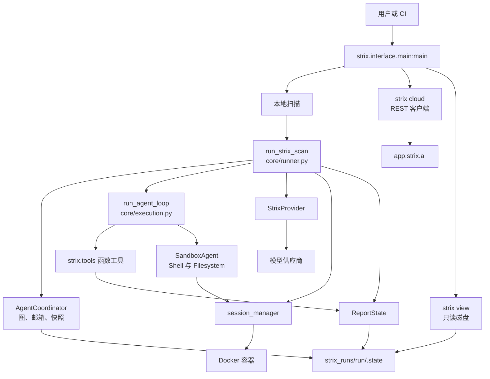
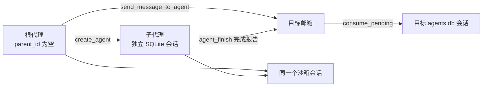
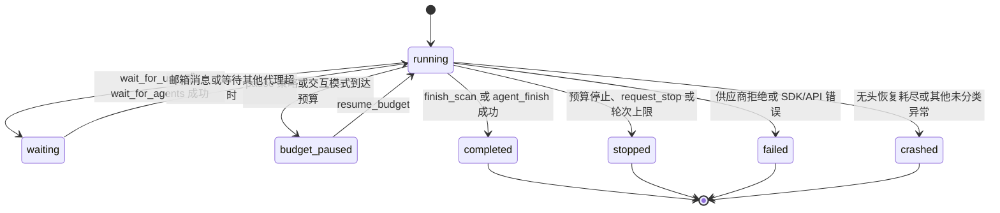

# Strix harness 深入分析

本文是对 `Silver-cybersec/strix`（fork 自 `usestrix/strix`）的只读静态分析。对象是 `main` 提交 `215482eb2204cd30ac6b87520e3f5c6511e2e2e8`，包版本 `strix-agent` 1.7.0（`pyproject.toml` 第 3 行）。阅读日 2026-11-16。没有安装依赖，没有运行仓库代码、测试、镜像或扫描器，没有对任何目标发请求，没有编写 PoC。

已有材料只作对照，不把它们的正文搬过来：

- PR #1 `SECURITY_AUDIT.md`，分支 `cursor/security-audit-16c0`
- PR #2 `CODE_ARCHITECTURE.md`，分支 `cursor/code-architecture-0544`
- PR #3 `DEEP_DIVE_AUDIT.md`，分支 `cursor/deep-dive-audit-8ff5`

这三份文件都不在当前 `main` 上。下面凡是引用它们，都标明分支。源码行号以本快照为准。

对照仓只读了指定分支上的架构说明，以及为第 8 节补读的安全审计。读不到的内容写「未读到」或「未核实」。

---

## 1. 结论摘要

Strix 是宿主编排、容器执行的长时程安全验证 harness：模型在本机 Python 进程里决定下一步，shell、浏览器和扫描器在 Kali 容器里跑，发现必须经结构化工具落盘。

编排是同一进程里的一棵可寻址代理树。纯文本不能结束运行；能收尾的是 `finish_scan`、`agent_finish`，交互模式下还有停车工具。

一次扫描的计划外置在 `strix_runs/<run>/.state/`：待办、笔记、覆盖率、威胁模型，加上每代理一条 SQLite 会话。同一轮可以 `--resume`。没有跨任务的经验库，也没有自动改写 harness 的回路。

按 Harness² 的八个可编辑组件来看，系统提示和技能可以改文件或用钩子替换；护栏、脚本和工具环内插件没有独立、可单独换上的组件文件。模型权重可以换，harness 不会在不改模型的前提下自己迭代。

开源树包含扫描模式、白盒/黑盒、无头退出码、SARIF 2.1.0，以及两套互不加载的 skills。`strix-pro` 的 PR 审查收尾工具、云端执行器、企业 DOCX、排程和团队看板不在本仓库。

和六份对照架构放在一起：Strix 让模型在运行中招人并共享一个容器；Shannon 把阶段编译进 Temporal；ARTEX、pentest-platform、RedAmon 用持久图加人机闸门；CyberStrikeAI 把审批放进工具中间件，默认却关掉审批；sapper-v2 把推理引擎外包给 Claude Code / Codex，自己留下事实—意图图。

PR #1 把总体风险定为高：来自特权容器、默认可写源码挂载、`host.docker.internal` 和默认遥测，不是本 fork 新增的后门。PR #3 核实了 `strix-sandbox:1.4.0` 的运行阶段与当前 Dockerfile 对应，并维持这一评级。

若只在隔离实验室里选三个来看 harness 差异，本文选 Strix、Shannon、ARTEX。选择理由、必做加固和观察指标在第 8 节。

---

## 2. 架构深入

Strix 把「谁在思考」和「谁在碰目标」拆成两个信任域，再用磁盘上的账本把一次可能超过上下文窗口的扫描接起来。

### 2.1 进程与模块分层

一次本地扫描只有一个 Python 解释器；沙箱是另一个容器进程；交互界面再加一个 Go 边车；`strix view` 和 `strix cloud` 是另外两条进程路径。

- 入口分发在 `strix/interface/main.py` 第 430 行起的 `main()`。`view`、`auth`、`completions` 先被拆走；第 465–470 行在参数解析和 Docker 检查之前处理 `strix cloud`。
- 扫描装配集中在 `strix/core/runner.py` 第 215 行 `run_strix_scan`。CLI 与 TUI 都进这一个函数。
- 无头界面在 `strix/interface/cli.py`。交互界面是 Go `strix-tui` 加 `strix/interface/tui/backend/` 的本地协议。扫描任务仍是这个 Python 进程里的 `asyncio` 任务。
- `strix view` 用标准库 HTTP 读磁盘，不附着内存里的协调器。本地 PDF 在 `strix/interface/viewer/report_pdf.py`，与扫描循环分开。
- 云客户端在 `strix/interface/cloud/`。它发 REST 请求，不调用 `run_strix_scan`。服务端如何调度代理，本仓库没有实现。

### 2.2 Agent 图如何创建与通信

图的唯一所有者是进程内的 `AgentCoordinator`。代理之间没有独立消息总线；邮箱在下一轮开始前被写成目标会话里的 `role=user` 条目。

- `AgentCoordinator` 定义在 `strix/core/agents.py` 第 56 行。状态字面量在第 25 行：`running`、`waiting`、`completed`、`stopped`、`crashed`、`failed`、`budget_paused`。`waiting` 另有 `WaitKind`（第 38 行）：`user`、`agents`、`stalled`。
- 根 id 是新运行时生成的 8 位 hex。恢复要求 `.state/agents.json` 与 `.state/agents.db` 同时存在（`strix/core/runner.py` 第 283–289 行一带）。
- 子代理由工具 `create_agent` 发出（`strix/tools/agents_graph/tools.py` 第 495 行）。执行层 `spawn_child_agent`（`strix/core/execution.py` 第 389 行）注册子 id、打开会话、`asyncio.create_task` 跑同一个 `run_agent_loop`。
- `inherit_context` 默认 `True`。为真时，子代理开场拿到父级 `ctx.turn_input` 的一份列表（同文件第 576 行），再合成一条 user 消息。这是对话继承，不是空上下文的子代理。
- `send`（`strix/core/agents.py` 第 425 行）把消息放进目标邮箱并唤醒。无头模式下终态且 `resumable=False` 的代理会把后续消息丢掉。
- `consume_pending`（第 494 行）把邮箱排进该代理自己的 SDK 会话。用户消息保持原文；其他发送者被包成 `[Message from <name> (<id>) | type=... | priority=...]`（第 609–626 行）。
- 根和子共享同一个沙箱会话、同一份 Caido 客户端、同一个 `McpRegistry`。`_start_child_runner` 用 `dict(parent_ctx)` 做浅拷贝，再改 `agent_id`、`parent_id`、`task` 和软轮次上限（`strix/core/execution.py` 第 1179–1185 行）。
- 工具层没有拿掉根代理的 shell。`SandboxAgent` 对根和子都挂 `Filesystem` 与 `Shell`（`strix/agents/factory.py` 第 807 行起）。系统提示第 4–10 行的 `<root_agent_directive>` 要求根代理只编排。`create_agent` 的文档字符串第 524–528 行又写：一次性探测可以自己做。两份文字同时在树里。能力隔离以工具列表为准，角色分工以提示词为准。

### 2.3 主循环

内层仍是「模型 → 工具 → 结果写回会话」。回合结束条件是生命周期工具的 JSON 成功标记，不是模型停止调用工具。

- `run_agent_loop` 在 `strix/core/execution.py` 第 233 行。真正的循环是第 539 行 `_run_until_lifecycle`。
- 第 555–561 行写明：没有 `finish_scan`、`agent_finish`、`wait_for_user`、`wait_for_agents` 的回合保持 `running`。纯文本被追加一条恢复提示，要求改叫生命周期工具。
- 无头恢复上限是 `max(1, max_turns)`（第 566 行）。`DEFAULT_MAX_TURNS = 500`（`strix/config/settings.py` 第 14 行）。耗尽后状态变为 `crashed`。
- 交互模式只试 3 次（第 536 行 `_INTERACTIVE_TOOL_RECOVERY_LIMIT`），然后停在 `waiting` 且 `wait_kind="stalled"`。`wait_for_user` 之前若还没对用户写出助手文本，这次停车会被撤销（第 625–630 行）。
- 判定函数 `_finish_tool_use_behavior` 在 `strix/agents/factory.py` 第 600 行。只有完成标记或成功停车才把该轮收成最终输出（第 567–597 行）。第三个名字 `finish_pr_review` 在第 572 行，注释写由 strix-pro 注册。本仓库没有这个工具的实现。
- `think` 是 `_BASE_TOOLS` 里的普通函数工具（`factory.py` 第 634 行），用来把计划留在对话里。系统提示第 156 行要求非平凡步骤先 `think`。没有单独的思维通道。
- 幻觉出来的工具名走 `tool_not_found_behavior="return_error_to_model"`（`runner.py` 第 443 行），变成一条工具错误，不终止扫描。

### 2.4 状态：待办、笔记、覆盖率、威胁模型

共享可变状态承担「计划」的角色，而且当次运行里随时能改。单文件损坏会记日志并从空账本开始；漏洞索引损坏则拒绝继续，避免用新的 `vuln-0001` 盖住旧 Markdown。后一条是 PR #2 已经对齐过的 `ReportState` 策略，这里不展开实现。

| 状态 | 工具 | 磁盘 | 代码 |
| --- | --- | --- | --- |
| 待办 | `create_todo` 等 | `.state/todos.json` | `strix/tools/todo/tools.py` 第 1、41–43 行 |
| 笔记 | `create_note` 等 | `.state/notes.json` | `strix/tools/notes/tools.py` 第 1、57 行 |
| 覆盖率账本 | `record_coverage` / `update_coverage` / `list_coverage` | `.state/coverage.json`，并汇总到运行目录 `coverage.json` | `strix/tools/coverage/tools.py` 第 1、13、77 行 |
| 威胁模型 | `get_threat_model` / `save_threat_model` / `amend_threat_model` | `.state/threat_models.json` | `strix/tools/threat_model/tools.py` 第 1、216 行 |
| 图 | 协调器快照 | `.state/agents.json` | `agents.py` 第 637 行 `snapshot` |
| 对话 | 每代理 `SQLiteSession` | `.state/agents.db` | `strix/core/sessions.py`；路径常量在 `strix/core/paths.py` 第 8–19 行 |

- 扫描开始时 `runner.py` 第 335–338 行依次 `hydrate_*_from_disk`。
- 待办损坏时从空表开始（`todo/tools.py` 第 50–54 行）。笔记、覆盖率、威胁模型是同一模式。
- `agents.json` 用同目录临时文件再替换。`asyncio.Task` 和活流不进快照；恢复时按元数据重新建任务。
- 这些账本的寿命是一次 `run_name`。下一次新扫描不会自动读上一次的笔记或威胁模型。跨运行继承只发生在 `--resume` 指向同一目录时。

### 2.5 上下文管理与压缩

压缩发生在每轮模型调用之前，对象是该代理自己的会话，不是全局账本。账本留在磁盘上，摘要只覆盖对话。

- `maybe_compact` 在 `strix/llm/compaction.py` 第 340 行。`STRIX_CONTEXT_AUTO_COMPACT` 默认开启（`settings.py` 第 148 行）。关掉之后只在供应商报上下文溢出时 `force=True` 再压。
- 窗口用 LiteLLM 元数据估计，缺元数据时用 `STRIX_CONTEXT_FALLBACK_TOKENS`，默认 200000（第 151–152 行）。缓冲默认 20000 token，尾部保留默认 8000（第 149–150 行）。
- 第 369–391 行：旧条目切成一段，调用同一模型做摘要，写成检查点，保留尾部。切分点避开未闭合的工具调用。摘要失败则本轮不改写会话。
- 工具输出按 token、行数、字节封顶，默认 8000 token、2000 行、50 KiB（`settings.py` 第 155–159 行）。溢出全文由 runner 写到沙箱 `/workspace/.tool-output/<id>.txt`（`runner.py` 第 412 行 `configure_spill_writer`）。模型在对话里看到切片和路径，再用文件工具读回。
- 图片工具结果默认每个会话保留 3 张（`settings.py` 第 172 行 `STRIX_MAX_CONTEXT_IMAGES`）。
- 系统提示用 `<cache_point>` 把稳定前缀和本轮范围拆开（`strix/agents/prompt.py` 第 19–21 行）。人人都有的技能在前，调用者点名的技能在后（第 131–135 行）。Claude 且走 LiteLLM 时，这些标记会拆成多条 system 消息；其他路线删除标记。PR #2 的这一条与 `prompt.py` 的注释一致。
- 预算是全扫描共享的。`stop` 在 70/85/95% 注入收尾提示，子代理在 90% 被停（`strix/core/hooks.py` 第 57–60 行）。`pause` 不告诉模型有限额，在 `on_llm_start` 抛 `BudgetPausedError`，会话保持原样，恢复后重发同一次调用。CLI 只传金额上限，策略默认是 `stop`。

### 2.6 工具注册与调用协议

宿主工具是 `@function_tool` 单例。沙箱能力不在这份名单里，由 SDK 在每次建代理时绑到活会话。

- 名单 `_BASE_TOOLS` 在 `factory.py` 第 633–677 行：思考、技能、待办、笔记、覆盖率、威胁模型、网页检索、漏洞报告、Caido 代理、MCP 五件套、图和子代理。
- `register_agent_tools`（第 698 行）必须在第一次 `build_strix_agent` 之前调用。之后的根和子都会拿到。重名直接 `ValueError`。这是进程内全局表，不是按扫描隔离。
- 交给模型前有三层包装：参数强制（字符串形式的数组/对象）、strict schema 开关、成功和异常都收成有界字符串（第 790–795 行对函数工具统一做）。`exec_command`、`write_stdin`、`view_image`、`apply_patch` 另有沙箱侧包装。PR #2 已逐项写过；本快照工厂代码里仍然没有 `apply_patch` README 所说的改名表。
- MCP 不把远端工具铺进首轮 schema。暴露的是 `list_mcps`、`search_mcp_tools`、`get_mcp_tool_schema`、`describe_mcp`、`call_mcp`（第 667–671 行）。连接失败记日志后继续。
- 并行工具调用默认关（`settings.py` 第 77–79 行 `STRIX_PARALLEL_TOOL_CALLS`）。提示词在关闭时要求每轮恰好一个工具调用（`system_prompt.jinja` 第 50 行）。
- 每个子代理点名技能最多 5 个（`strix/skills/__init__.py` 第 225–234 行；工具文档第 517–520 行）。

### 2.7 沙箱边界

容器是工具执行域。宿主进程仍然持有 Docker 套接字，才能创建这个容器。PR #1 因此把「产品固有危险能力」定为高；这里只标边界落在哪几行。

- 默认镜像 `ghcr.io/usestrix/strix-sandbox:1.4.0`，无 digest（`settings.py` 第 166–169 行）。后端默认 `docker`（第 170 行）。
- `strix/runtime/docker_client.py` 第 251–260 行每次创建都追加 `NET_ADMIN` 和 `NET_RAW`，并写入 `host.docker.internal` → `host-gateway`。`SYS_ADMIN` 只在带 FUSE 的挂载分支出现（第 236–241 行）。PR #3 核实：默认 manifest 下 `SYS_ADMIN` 关闭，两条 NET capability 仍在。
- 本地代码目录 bind mount 到 `/workspace/<subdir>`，默认可写。`.git` 等再盖一层只读。PR #1 写明家目录和若干凭据目录不能当目标，`.env` 不在拒绝名单里。
- 容器内 HTTP 代理指向本容器 Caido `127.0.0.1:48080`。宿主上的 `list_requests` 等工具用 `caido_sdk_client` 读这条历史。
- 网页检索和 MCP 在宿主执行，不经过容器。这是离开沙箱的出站路径。
- 浏览器不是函数工具。镜像里的 `agent-browser` 经 `exec_command` 调用，玩法在始终加载的技能 `tooling/agent_browser`。

### 2.8 LLM 适配层

模型名不写在 `Agent` 上（`factory.py` 第 812 行 `model=None`），写在每次运行的 `RunConfig.model` 里（`runner.py` 第 435–437 行）。根和子因此共享一个 `StrixProvider` 和同一套 `ModelSettings`。

- `StrixProvider` 在 `strix/config/models.py` 第 563 行，继承 SDK `MultiProvider`。`ollama/<name>` 改写成 `ollama_chat/<name>`（第 610 行）。`anthropic/`、`openrouter/` 等整串交给 LiteLLM。
- `chatgpt/` 订阅走另一条 Codex Responses 客户端，不经过上述前缀表。
- `configure_sdk_model_defaults` 关掉 SDK tracing（第 707 行 `set_tracing_disabled(True)`），并安装本仓库自己的请求日志。`RunConfig` 另把 `trace_include_sensitive_data` 设为假（`runner.py` 第 440 行）。
- 默认重试最多 5 次，初始 2 秒，上限 90 秒，覆盖建议重试、网络错误和 429/500/502/503/504（`models.py` 第 688–699 行）。执行层在 SDK 之外还有自己的瞬态重试。内容护栏错误不重试。
- 查重可以换模型：`STRIX_DEDUPE_MODEL` 及独立的 key / base。它不进入代理循环。

### 2.9 报告与产出

发现不是模型的自由文本。它是一次通过字段校验的工具调用，随即重写运行目录里的一组文件。

- `ReportState._write_artifacts` 在 `strix/report/state.py` 第 857 行。每次新增、更新、删除和结束都重写。
- 产物包括 `run.json`、`penetration_test_report.md`（仅在已有终稿时）、`vulnerabilities/vuln-NNNN.md`、`vulnerabilities.json`、`vulnerabilities.csv`、`findings.sarif`、`coverage.json`。
- SARIF 2.1.0 的模式常量在 `strix/report/sarif.py` 第 63–64 行。第 878–883 行写明即使没有发现也发一份，避免 CI 把旧告警留着不关闭。SARIF 失败不挡住 CSV / Markdown / `run.json`（第 884–893 行）。
- 无头退出码在 `main.py` 第 549–552 行：`findings_fail_build` 为真则 `sys.exit(2)`。`--fail-on` 的含义在 `cli_args.py` 第 200–206 行。退出码 2 看严重性门槛，不看模型是否调用了 `finish_scan`。
- 查重失败时放行写入。`check_duplicate` 在异常、空回复或未配置模型时返回 `is_duplicate: false`（`strix/report/dedupe.py` 第 347–433 行）。这是代码路径，不是误报率测量。

---

## 3. 功能清单

开源 CLI 是完整的本地引擎。云端和 strix-pro 在本树里只留下客户端、注释和钩子。

### 3.1 扫描模式

模式只改系统提示词里拼进哪一份技能，不改工具集，也不在调度器里设墙钟超时。

- CLI 选项 `quick` / `standard` / `deep`，默认 `deep`（`strix/interface/cli_args.py` 第 209–220 行）。
- 渲染时追加 `scan_modes/<mode>`；diff 范围再叠加 `scan_modes/diff`，不替换深度模式（`strix/agents/prompt.py` 第 54–56 行）。
- 文档 `docs/usage/scan-modes.mdx` 和 `docs/integrations/ci-cd.mdx` 第 13 行把 `quick` 写成 CI 用法。仓库没有把「几分钟 / 几小时」写成代码里的截止时间。

### 3.2 白盒与黑盒

白盒是「目标类型里有本地代码」时多加载的一组技能，加上源码目录被挂进容器。黑盒是 URL、IP、规范等目标走同一套工具循环，只是不加载那一组技能。

- `runner.py` 第 420 行：任一目标 `type == "local_code"` 则 `is_whitebox`。
- 白盒额外技能：`coordination/source_aware_whitebox`、`custom/source_aware_sast`、`analysis/source_aware_discovery`、`analysis/fix_verification`（`prompt.py` 第 63–67 行）。
- 始终加载、与白盒无关的技能包括 `tooling/agent_browser`、`tooling/python`、`analysis/counterevidence`、`analysis/severity_calibration`（第 57–60 行）。反证和严重性校准是提示词纪律。它们不是独立的复现器进程。
- 目标类型推断在 `strix/interface/scan_setup.py`。`localhost` 会被改写成 `host.docker.internal`，以便容器访问宿主上的服务。PR #1 把这条改写列为隔离必须处理的默认行为。

### 3.3 CI 集成

产品侧的 CI 契约是无头进程、退出码和 SARIF。本仓库的 GitHub Actions 是项目自己的 lint / 打包，不是给用户用的官方 Action。

- 用法写在 `docs/integrations/ci-cd.mdx` 第 10–34 行：`-n`、`--scan-mode quick`、`--scope-mode diff`、`--fail-on`。退出码 0 / 1 / 2 的表在第 22–28 行。
- `docs/integrations/github-actions.mdx` 第 24 行的示例用 `curl -sSL https://strix.ai/install | bash`。PR #1 第 4.2 节把这条安装器列为实验室里不要跑的路径：它安装上游 release，不校验下载字节，也不安装本工作树。
- `.github/workflows/ci.yml` 跑的是 mypy、bandit、Go 与前端构建。`.github/workflows/binary.yml` 会在打包后对 `/tmp/target` 做一次 `--scan-mode quick`，那是发布物冒烟，不是用户的扫描模板。

### 3.4 SARIF

`findings.sarif` 是 SARIF 2.1.0，给 GitHub code scanning 一类消费方用。空结果也写。多个 `repository` 目标时省略仓库出处，避免把后面的发现算到第一个仓库头上。规则 id、严重性映射和 fix 字段的细节在 `strix/report/sarif.py` 文件头第 1–40 行，PR #2 第 5.6 节已逐项对齐，这里不重复字段表。

云客户端也能下载 SARIF：`strix/interface/cloud/spec.py` 第 232 行有对应 verb。那是把平台上的结果拉回来，不是本地 `write_sarif` 的远程实现。

### 3.5 两套 skills

仓库根 `skills/` 和包内 `strix/skills/` 不是同一加载器的两个目录。

- `skills/*/SKILL.md` 是给 Cursor、Claude Code 等外部编码代理的操作手册。例如 `skills/penetration-testing-with-strix/SKILL.md` 第 1–15 行教的是如何调用 `strix` CLI 或 `strix cloud`。渗透循环不会 `load_skill` 这些文件。
- `strix/skills/**/*.md` 才进入引擎提示词。`strix/skills/README.md` 第 30–39 行列出用户可选类别：vulnerabilities、frameworks、technologies、protocols、tooling、cloud、reconnaissance、custom。
- `scan_modes`、`coordination`、`analysis` 被标成内部类别（`strix/skills/__init__.py` 第 27 行），不出现在 `get_available_skills()` 的用户名单里（第 208 行）。渲染器按角色塞入。
- `register_skill_dir`（第 38 行）可在运行前加一个根目录，后注册的遮蔽内置同名技能。这是人手扩展点，不是扫描过程中的自动改写。

### 3.6 遥测与云端交互

遥测默认开启。云端是另一条 CLI，不在本地引擎里执行扫描。

- `TelemetrySettings.enabled` 默认 `True`，环境变量 `STRIX_TELEMETRY`（`settings.py` 第 178 行）。关闭方式写在 `strix/telemetry/README.md`。
- PR #1 已列出 PostHog 与 Scarf 的主机、公开 ingest key，以及实际字段（系统、版本、模型名、扫描模式、发现计数和 CWE、token 与费用、技能名、异常类名）。该审计写明不发送异常消息和堆栈。本文件不重复那张地址表。
- 版本检查默认开启。`strix --update` 才会下载上游 release 并覆盖当前可执行文件。PR #1 第 1.4 节：没有 digest 时打印提示并跳过校验。
- `strix cloud` 覆盖登录、工作区、域名、上传、扫描、漏洞列表、账单和 GitHub 集成安装。`--data`、退出码 0/1/2/4/5、上传限额和 `--approve-sha256` 都在 `strix/interface/cloud/`。AGENTS.md 把本地和云端写成同一引擎的两种运行方式。就本仓库而言，能核对的只有客户端契约。

### 3.7 开源树里缺失的部分

下列能力在注释、技能或云客户端文案里出现，实现不在这个快照里。

- `finish_pr_review`（`factory.py` 第 572 行）和 MCP `result_transform`（`strix/tools/mcp/registry.py` 第 17、298 行）标明属于 strix-pro。本树没有 PR 审查代理，也没有云端 MCP 结果清洗器。
- 企业 DOCX、团队看板、排程、PR 审查和内网连接器写在 `skills/managed-pentesting-with-strix/SKILL.md` 与 `docs/integrations/coding-agents.mdx`。云 spec 第 182 行写明 DOCX 需要 Enterprise。本地 viewer 能用 reportlab 出 PDF，那是另一条代码路径。
- 评测脚本和运行数据指向仓库外的 `usestrix/benchmarks`（本仓 `benchmarks/README.md` 第 8 行）。本仓只保留一段自报结果，见第 7 节。没有在扫描循环里读取上一次评测、再改写技能或提示词的代码。

---

## 4. 与对照仓库的对比

下表只比较 harness 形状。材料是各仓指定分支上的 `CODE_ARCHITECTURE.md`，以及第 8 节用到的安全审计。没有把某一仓的功能清单当成另一仓的能力。成熟度一列只用仓库自己写出的版本或分类，不打星，也不引用未复跑的成功率。

| 维度 | Strix `215482e` | ARTEX 架构分支 `1de6d2c`（对象 `a05a886`） | sapper-v2 架构分支 `6e69356`（对象 `d4de077`） | pentest-platform 架构分支 `8a572e7` | Shannon 架构分支 `ebfa857`（对象 `4cef63e`） | CyberStrikeAI 架构分支 `e175629`（对象 `b43bdb99`） | RedAmon 架构分支 `deaa160`（对象 `046921e`，VERSION 7.7.0） |
| --- | --- | --- | --- | --- | --- | --- | --- |
| 定位 | 本地自主应用安全验证；云端只有客户端 | 单 Go 进程的任务引擎：HTTP、内嵌界面、双图、流量代理 | 授权攻防竞赛的多代理 harness，事实—意图图加 tmux 编队 | 自托管 ASM 加三层渗透引擎，节点反连控制端 | 白盒流水线：源码只读挂进 Worker，对运行中的 Web/API 取证 | 单 Go 进程的授权安全工作台，MCP 工具执行 | 自托管平台：侦察流水线进 Neo4j，再由阶段化代理在 Kali 里验证 |
| 编排模式 | 单进程、运行中生长的代理树；根与子几乎同工具 | 人机共图：goals / planner / worker / mainagent；角色不互聊 | 人机共图加进程编队；指挥官雇 worker；同题共享一张图 | 人机共图：PM、Planner、PA 三层；数据库是总线 | 流水线：Temporal 固定阶段；阶段内才是工具循环；代理不互聊 | 单代理、Deep、Supervisor、plan-execute、图工作流并存 | 流水线侦察加 LangGraph 状态机；fireteam 由根代理扇出 |
| 规划与状态载体 | 无冻结计划；`.state` 待办/笔记/覆盖率/威胁模型 + SQLite | 探索图与资产图在 PostgreSQL；planner 待办在进程内，重启丢失 | `.sapper/` 一文件一节点；`SKILL.md` 是跨题策略 | MySQL 台账加探索图；Planner 每轮全新上下文 | 计划在 `workflows.ts`；可恢复性靠 Temporal、`session.json` 和交付物 git | SQLite 轨迹、项目事实、压缩笔记；计划 DAG 不单独落库 | Neo4j 攻击面与攻击链；会话检查点在 Postgres；阶段是字面量 |
| 工具执行与隔离 | Docker Kali；根与子共享容器；宿主持有 Docker 套接字 | 任务进程内执行；`permission.ModeBypass`，拦截规则才是门 | 容器内 Claude/Codex CLI；竞赛镜像跳过权限确认 | shell/浏览器在节点；平台进程不跑扫描命令；PA 内核注释写明没有移植沙箱 | 一次性 Worker 容器；目标仓库只读；容器持有模型密钥 | 工具、可选 WebShell 与 C2 默认同进程；隔离靠部署 | Kali MCP 沙箱；编排器持有 Docker 套接字；侦察容器走过滤后的 broker |
| 模型绑定 | LiteLLM 风格 id，可换供应商；查重可另选模型 | 按任务/worker pool 选 `llm_profiles` | 默认 `claude -p`；`SAPPER_BIN` 可换兼容 CLI | 不配 LLM 时测绘仍可跑；判断管道才调用模型 | 一次扫描一个 `SHANNON_AI_MODEL`，默认 `anthropic:claude-sonnet-4-6` | 模型通道有 retry / failover；角色缩小工具集 | 阶段和护栏在代码里；模型只产出 `LLMDecision` |
| 可观测性 | `run.json`、代理快照、SQLite 会话、TUI/viewer；SDK tracing 关闭 | `activity` 轨迹、探索血缘、流量、LLM 用量 | HTML 图、tmux 窗格、JSON 节点 | 图投影、`RunActivity`、车道 transcript | Temporal 历史、交付物目录、`workflow.log` | `tool_executions`、轨迹回放；聊天不走 ADK checkpoint | 攻击链、对话表、WebSocket；挂起标志就是人在环状态 |
| 验证 / 去误报 | 报告字段校验 + 另一次模型查重；查重失败放行。反证写在技能里 | finding 由 worker 写入图；`proves` 边连接事实与漏洞 | `verify` 模板可选；破坏性步骤靠 `requires_confirmation` 提示词 | 证明纪律写进任务书；零 LLM 的 `engine_pass` 回收终态 | 默认 `exploit === true` 时，队列里没有可执行项则跳过该类利用代理 | `agentfinalizer` 用证据和挂起工具核对后才算最终答复 | 阶段门、RoE、工具确认；护栏出错则拒绝 |
| 可扩展性 | `register_agent_tools` / `register_skill_dir` / `register_backend`；MCP 五件套 | 技能、MCP、自定义工具要改绑定；工具 `Call` 改不了 | 换 CLI、改模板和 `SKILL.md`；角色不是类 | 交战模式是数据闸；C2 后端择一注册 | 五类分析面写死；加一类公开分析代理要改工作流 | YAML 工具、`agents/*.md`、外部 MCP、图工作流 | 技能文本覆盖；插件经 Gateway 提议，代理进程不调用插件代码 |
| 成熟度（只写仓库自述） | 1.7.0；`pyproject.toml` 分类 Development Status :: 3 - Alpha | 架构文锚在 `a05a886`；细查把已发布镜像追溯到上游标签 `v0.3.27`，与该 `main` 不是同一提交 | 架构文：`__version__` 仍是 1.0.0，CHANGELOG 记到 1.1.0 | 公开快照历史被压扁；架构文写明容器配方和历史提交不在该快照 | 固定 14 个业务代理名加认证校验；Keygraph Pro / Enterprise 不在本仓 | 单体 Go + SQLite；旧自研 ReAct 循环已删除，现走 Eino ADK | VERSION 7.7.0；代理白皮书 4.13.0 与当前节点名已不完全一致 |

### 4.1 关键差异

- Strix 的「多代理」是运行时招人：父代理写 `task` 和最多 5 个技能，子代理立刻成为另一个 `asyncio.Task`。Shannon 的名单和顺序在源码里，模型改不了全局图。ARTEX 和 pentest-platform 也拆了规划者与执行者，但规划者每轮是新会话，必须把判断写回图，否则下一轮就没了。
- Strix 的人在环是交互模式下的 `wait_for_user` 和预算暂停。无头模式没有逐次工具审批。ARTEX 的默认拦截名单包含 Bash 等工具，未命中时的 LLM 兜底默认关闭、调用放行（审计第 7 节）。CyberStrikeAI 有 HITL 闸门，审计写明默认关闭人机审批。RedAmon 把阶段跃迁和危险工具确认做成图上的挂起状态。
- Strix 用文件账本避开「一个上下文打完全程」，但账本不跨 `run_name`。sapper-v2 的 `.sapper/` 和 RedAmon 的 Neo4j 攻击链明确为了下一次会话接着用。Harness² 的经验库是第三种东西：留下的是 harness 组件和教训，不是漏洞事实。Strix 没有这一种。
- Strix 把模型供应商留在 LiteLLM 适配层。Shannon 一次扫描绑一个模型 id。sapper-v2 连循环都不自建，默认调用 `claude -p`。pentest-platform 把「不配模型也能测绘」写成一条独立管道。
- 验证强度差在契约上。Shannon 默认把「没有可执行项就不为该类编利用报告」写进工作流。Strix 要求报告字段里有技术分析、PoC 描述和反证字段，再用另一次模型调用查重；调用失败仍落盘。CyberStrikeAI 用终结器核对证据。这些都是静态契约，本文没有测量误报率。
- 部署形状决定实验室成本。Strix 是一个 Python 进程加一个容器。Shannon 还要 Temporal 和 Worker 镜像。ARTEX 是 Go 加 PostgreSQL。pentest-platform 是多个 Django 进程、MySQL 和反连节点。RedAmon 是整套 compose（可选 GVM）。CyberStrikeAI 进程数少，默认监听和 C2 使加固清单变长。sapper-v2 进程模型简单，镜像构建不锁 Claude Code 版本。

---

## 5. 现代 harness 设计理念评估

本节用四份读到的公开材料作尺子，再对照本仓源码。跑分只引用作者原文，并标明没有独立复现。

### 5.1 评估维度与出处

| 维度 | 出处 | 本文采用的含义 | 读取情况 |
| --- | --- | --- | --- |
| 工作流与自主代理 | Anthropic，Building effective agents，2024-12-19，https://www.anthropic.com/engineering/building-effective-agents | 工作流是代码规定路径；代理是模型自己决定工具和步骤。文中的 orchestrator-workers、evaluator-optimizer 用来对号 | 已读。页面注明文中工具生态自 2024-12 已变化 |
| ACI，即工具接口 | 同一篇文章附录 2 | 工具文档、参数形状和防错要单独设计，并拿真实调用去改 | 已读 |
| 简单与透明 | 同一篇文章总结的三条原则 | 少抽象、把计划步骤显出来、先测量再加复杂度 | 已读 |
| 长时程的文件化进度与自检 | Anthropic，Effective harnesses for long-running agents，2025-11-26，https://www.anthropic.com/engineering/effective-harnesses-for-long-running-agents | 压缩不够；用进度文件、功能清单、增量提交和端到端自检把新会话接上 | 已读 |
| 子代理隔离上下文 | Harness² 论文附录 D.3 表 5；上文也把「多代理是否更好」留作开放问题 | 子代理用自己的窗口，只把结果交还 | 论文 HTML 与 arXiv API 已读 |
| 人类介入点 | 上文代理一节；OpenAI Agents SDK 文档把 Human in the loop 列为原语，https://openai.github.io/openai-agents-python/ ，本文读取日 2026-11-16，页面未标文档发布日期 | 阻塞时能停下来等人，而不是只在提示词里写「可以问」 | SDK 页已读；发布日期未核实 |
| 权限与沙箱 | 同一 SDK 页的 Sandbox agents；Strix 自己的容器代码 | 工具执行有隔离边界，权限不靠提示词单独成立 | SDK 页已读。该页描述的是当前 SDK 文档，不是 Strix 锁定的 0.19.0 手册；0.19.0 与文档的逐条差异未逐项重核 |
| 可观测与可回放 | SDK 页把 tracing 列为内建能力 | 一次运行能复盘工具、决策和花费 | SDK 页已读 |
| 评测驱动 | 上文「先测量再加复杂度」；Harness² 的任务级与跨任务回路 | 有固定任务、有对照运行、结果能改 harness | 已读 |
| 模型无关 | Harness² 把模型权重冻住、只改 harness；Strix 的 provider 层 | 换模型不改编排代码 | 已读 |
| 八个可编辑组件 | Harness² README「Harness components」；论文第 2.1 节与附录 D.3 表 5 | system prompt、guardrails、memory、tool guidance、subagents、skills、scripts、plugins。每个是文件，编辑即 diff | README 与论文已读 |
| 任务级 Propose–Probe–Compose | 论文第 2.2 节；README 同名小节 | 提议编辑、在同一任务上探测、按行为差异合成，不靠标准答案 | 已读 |
| 跨任务 improvement harness | 论文第 2.3 节；附录 D.2 | 经验库保留被采纳的 harness 和 `EXPERIENCE.md`，下一次从公共初始 harness 出发，用库来指导提议 | 已读 |

Harness² 坐标，均已读到：

- 仓库 https://github.com/google-research/harness2 ，本次浅克隆头 `6868817`，`pyproject.toml` 版本 `0.1.0`，`license` 为 Apache-2.0。README 声明这不是官方支持的 Google 产品。
- 论文 arXiv:2610.14224v1。arXiv API 条目 `updated` 为 `2026-10-09T18:34:25Z`。作者单位含 Google Cloud AI Research 与 Northwestern University。
- 作者自报、本次没有复现、也没有看到独立复现记录：一步对比改进在 GLM-5 与 Gemini 3.5 Flash 上，WorkBuddy-Bench 最多 +11.5，JobBench 最多 +4.5，LAB Partial 最多 +11.8 个百分点。并行递归还有额外增益（论文摘要与 README「Experiments」）。这些数字只代表论文中的模型—执行器配置，不能挪用来给 Strix 打分。

Escape 等第三方榜单本次没有打开，不引用。见第 7 节。

### 5.2 Strix 逐项判定

| 维度 | 判定 | 证据 |
| --- | --- | --- |
| 工作流与自主代理 | 部分符合 | 内层是模型自选工具的循环（`execution.py` 第 539 行）。外层没有编译好的阶段图。根代理被提示词要求当 orchestrator（`system_prompt.jinja` 第 4–10 行），工具层仍允许它自己调用 shell（`factory.py` 第 785–788、807 行）。没有独立的 evaluator 代理；查重是报告工具里的另一次模型调用（`dedupe.py` 第 347 行）。 |
| ACI | 部分符合 | 工具有 schema、参数纠错和有界输出（`factory.py` 第 790–795 行）。MCP 用检索而不是把全部远端工具塞进首轮。技能正文很长，和工具 docstring 一起构成「如何用」。仓库里没有「用一批固定输入观察模型用错了哪个参数、再改工具」的回路。 |
| 简单与透明 | 部分符合 | 编排是一个 Python 进程加 SDK `Runner`，计划步骤通过 `think`、待办和 TUI 可见。同时系统提示、内部技能、沙箱包装和预算钩子叠在一起，换一个行为常常要同时改提示词和 Python。 |
| 文件化进度 | 符合 | `.state` 四份账本、`agents.json`、`agents.db` 让新进程用 `--resume` 接上同一次扫描（`paths.py` 第 8–19 行，`runner.py` 第 335–338 行）。覆盖率账本承担「还没做完什么」的角色，接近长时程文章里的功能清单，但是渗透面清单，不是软件功能的 `passes` 字段。 |
| 压缩之外的外部状态 | 符合 | `maybe_compact` 只摘要对话（`compaction.py` 第 340–391 行）。待办和威胁模型留在 JSON 里，不靠摘要存活。 |
| 增量与自检 | 部分符合 | 子代理有软轮次提醒，预算在 70/85/95% 催收尾（`hooks.py` 第 57–60 行）。白盒技能里有 `analysis/fix_verification`。没有「每步结束必须留下可复跑检查、失败则不算完成」的代码门。反证是提示词。 |
| 子代理隔离上下文 | 部分符合 | 子代理有自己的会话 id 和 SQLite 行。默认 `inherit_context=True`，父级当轮输入会拷给子代理（`tools/agents_graph/tools.py` 第 499、576 行）。沙箱、Caido 和 MCP 注册表与父级共享。交回父级的是完成报告邮件，父级仍可 `send` 继续对话。 |
| 人类介入 | 部分符合 | 交互模式有 `wait_for_user`（`factory.py` 第 564、777–779 行）。无头模式没有逐工具审批。预算 `pause` 是库接口，CLI 默认 `stop`。 |
| 权限与沙箱 | 部分符合 | 有真实容器、资源上限环境变量和 capability 代码（`docker_client.py` 第 251–260 行）。默认 capability、可写挂载和 `host-gateway` 使边界宽于「最小权限沙箱」。宿主持有 Docker 套接字。根代理的「不许自己动手」没有对应的工具删除。 |
| 可观测 / 可回放 | 部分符合 | `run.json`、漏洞文件、协调器快照和每代理 SQLite 可以复盘一次扫描。SDK tracing 被关掉（`models.py` 第 707 行）。计时写入 `run.json` 默认关闭（`settings.py` 第 179 行）。没有把轨迹送进一个独立的评测器。 |
| 评测驱动 | 不符合 | `benchmarks/README.md` 指向外部仓库，并自报 v0.4.0 的 XBEN 结果（第 16–24 行）。本快照没有评测运行器，也没有「跑完一组任务再改技能」的代码。该自报数字不是 1.7.0 的测量，本文未复跑。 |
| 模型无关 | 符合 | `StrixProvider` 接受多种前缀（`models.py` 第 563、610 行）。换 `STRIX_LLM` 不改代理图代码。查重模型可分开配置。订阅路径是特例，仍不改编排。 |
| 八组件可单独替换 | 部分符合 | 见 5.3。能换的是提示词、技能目录和注册进去的函数工具。不能像 Harness² 那样对八个文件做 diff 后并排探测。 |
| Propose–Probe–Compose | 不符合 | 全库没有这一步的提议、对照执行和合成器。同一次扫描里的多个子代理是分工，不是同一任务上的 harness 对照实验。 |
| improvement harness / 经验库 | 不符合 | 笔记和威胁模型不进入下一次新 `run_name`。没有 `EXPERIENCE.md` 索引，也没有「保留被采纳的 harness、丢掉任务事实」的库。 |

### 5.3 八个组件是否解耦

Harness² 的组件是文件：改一行就是一次可探测的 diff。激活方式分为常驻、按需、以及工具环内强制执行（论文附录 D.3）。Strix 的对应物大多嵌在进程里。

| 组件 | Strix 里有什么 | 能否单独替换 | 判定 |
| --- | --- | --- | --- |
| system prompt | `system_prompt.jinja`、`scope.jinja`；`run_strix_scan` 可对根提示词做 override | 根提示词可以换。子代理仍用标准扫描提示。范围块、缓存标记和技能注入绑在同一个渲染函数里（`prompt.py` 第 78 行） | 部分符合 |
| guardrails | 生命周期判定、预算钩子、报告字段校验、容器 capability | 这些是 Python 控制流，没有一份 `guardrails.md` 可独立挂上。提示词里的范围说明模型可以不遵守，工具列表并不因此缩小 | 部分符合 |
| memory | `.state` 四账本 + SQLite | 格式由工具代码决定。可以改 JSON，不能把「记忆实现」换成另一个文件组件而不改加载器 | 部分符合 |
| tool guidance | 工具 docstring、`tooling/*` 技能、系统提示里的工具段落 | 技能 Markdown 可改。沙箱工具的包装在 `factory.py`，和说明文字分开 | 部分符合 |
| subagents | `create_agent` 动态创建 | 技能名单可传。子代理的工具集、沙箱和循环与根几乎相同，不能换一套「只返回短结果」的运行时 | 部分符合 |
| skills | `strix/skills/**/*.md`，`load_skill` 按需加载；一部分内部技能每次都注入 | `register_skill_dir` 可遮蔽同名技能。内部类别的注入顺序写死在 `_resolve_skills` | 部分符合 |
| scripts | 容器镜像里的扫描器和 `exec_command` 里的 Python | 没有与技能并排、随 harness diff 一起替换的 `scripts/` 组件。换一个确定性脚本意味着换镜像或在容器里现写文件 | 不符合 |
| plugins | 预算与用量钩子、工具包装、可选 MCP | 没有在工具环内强制执行、且可由编辑器当文件替换的插件目录。`register_agent_tools` 是进程启动前的代码注册 | 不符合 |

因此：八类里有六类能找到对应机制，其中脚本和插件没有 Harness² 那种可单独编辑的形态。没有任何一类是「只换文件、不改加载代码、就能并排探测」的完整组件。人手可以改技能和根提示词再重跑，这是人工迭代，不是框架里的 Propose–Probe–Compose。

不改模型而迭代 harness，本仓库提供的是：换 `STRIX_LLM` 以外的提示词覆盖、技能目录、扫描模式文件、MCP 配置和预算。缺少的是：固定任务集、对照运行、行为差异记录、以及把采纳结果写进下一任务仍会读的经验库。`benchmarks/README.md` 把评测放在另一个 GitHub 仓库，本引擎不读取它的输出。

### 5.4 与对照仓的简要横比

- ARTEX 把常驻规则拆成可编辑提示词段和数据库里的拦截规则，工具 `Call` 仍在代码里。探索图是跨唤醒记忆。没有 Harness² 式的对照探测；人通过 mainagent 改方向。规划者待办不落库。
- sapper-v2 的可编辑面主要是模板和 `SKILL.md`，引擎是外部 CLI。事实图跨会话。竞赛入口把权限确认跳过。没有经验库去改下一次的 harness，军规本身可以被模型在比赛中改写，那是提示词漂移，不是带证据的合成步骤。
- pentest-platform 把 PM / Planner / PA 的上下文寿命拆开，图是共享状态。PA 内核从编码代理循环演化而来，审计写明权限模式在空上下文里是 `bypassPermissions`，且没有移植沙箱。交战模式是数据闸，不是一套可 diff 的八组件。
- Shannon 最接近「工作流」：阶段、并发和「无利用项则跳过」在 TypeScript 里。提示词和收集器可改，全局图不可由模型改。会话是内存的，交接物是文件。没有跨扫描的 harness 经验库。
- CyberStrikeAI 的工具中间件（RBAC、HITL、`tool_guard`）最接近 Harness² 的 plugin：它在工具环内执行，提示词不能把它打开。默认配置把 HITL 关掉，所以这个组件在默认部署下不发挥作用。项目事实可以留给下一次会话，那是任务记忆，不是 harness 库。
- RedAmon 用阶段字面量、RoE 和确认门把非确定性关在 `think` 里。技能可以按项目覆盖文本。插件不能成为第四个大脑。攻击链跨会话。同样没有「提议一份新 harness、探测、再合成」的循环。

六份对照加 Strix，都是人改提示词或规则后再跑。读到的材料里，没有一份实现 Harness² 的任务级对照合成和跨任务经验库。CyberStrikeAI 与 ARTEX、RedAmon 把更多闸门做成代码或数据，而不是只写在系统提示里。Strix 的优势在模型适配和单次运行的文件账本；短板在闸门和评测回路。

---

## 6. 风险、短板、适合与不适合

PR #1 的总体判断是高风险、未发现本 fork 后门。PR #3 维持「危险能力：高」和「按 lock 的供应链：中」，并把「已发布镜像的运行阶段与 Dockerfile 对应」从无法确认改为已核实。下面只引这些结论，不重复两份审计的清单。

### 6.1 风险（只引结论）

- 隐藏后门、混淆载荷、凭据偷偷外发：PR #1 结论为未发现。一方出站地址对得上遥测、登录、云 API、自更新或渗透功能。
- 产品能力：模型输出会在带 `NET_ADMIN`/`NET_RAW`、免密 sudo 的 Kali 容器里执行；本地源码默认可写挂载；容器可通过 `host.docker.internal` 访问宿主机。PR #3 补充：`SYS_ADMIN`、`/dev/fuse`、`apparmor:unconfined` 默认关闭，不能据此把能力评级下调。
- 供应链：按 `uv.lock` / `package-lock.json` / `go.sum` 安装时，锁定版本未命中 OSV 恶意包记录，评级为中。`pyproject.toml` 对 `litellm` 等没有上界；按 Dockerfile 构建使用 `latest` 和未校验下载，该路径评级为高。PR #3 核实 `openai-agents` 0.19.0 与 PyPI 及 GitHub tag 一致，没有被替换；`docker_client.py` 注释里的 `0.14.6` 与 lock 不一致，只说明注释过期。
- 遥测和版本检查默认开启。viewer 主动发送报告时会把 target 字符串发到默认的 `app.strix.ai`。PR #1 把这些写成产品功能，并要求实验室显式关掉。
- 查重失败放行（`dedupe.py` 第 426–433 行）和根代理提示词/工具列表不一致（第 2.2 节）是 harness 短板，不是 PR #1 意义上的后门。它们让「报告已经过去重」和「根代理没有亲手执行」这两句不能从静态结构上成立。

### 6.2 适合的场景

- 已获授权、网络可隔离的实验室：对自己的代码目录、仓库、URL 或 API 规范做白盒、黑盒或两者一起的扫描，并接受容器里会执行模型选择的命令。
- 需要换模型供应商的对比：`STRIX_LLM` 与查重模型可以分开，编排代码不动。
- 需要留下 SARIF 和退出码、交给已有 CI 消费的无头运行。前提是安装路径和镜像引用先按 PR #1 第 4.2 节收紧，而不是使用文档示例里的 `curl | bash`。
- 研究「单次长运行如何用文件账本和子代理接住上下文窗口」。`.state` 与 `--resume` 是这条问题的现成实现。

### 6.3 不适合的场景

- 未隔离的办公机或带云元数据、生产凭据的主机。PR #1 写明：把它当成低权限、默认可信的扫描器不合适。
- 要求零出站却不改默认配置的环境。遥测、版本检查、网页检索和云报告都会离开本机。
- 把退出码 0 当成「目标已经安全」。0 只说明这次进程没有把发现当成失败。还要看 `run.json` 的 `status` 和花费是否顶到预算。
- 希望框架自动迭代提示词和技能。本仓库没有这条回路。
- 需要多租户、排程、企业 DOCX 或 PR 审查代理。这些在云端或 strix-pro 的文案里，不在本树。
- 需要逐条命令人工批准后再执行。无头 Strix 没有这个闸门。该需求更接近第 8 节里 ARTEX 或 RedAmon 的形态，后两者仍要先做各自审计列出的加固。

---

## 7. 未覆盖与待核项

- 没有运行测试、类型检查、镜像或容器。PR #3 对 `strix-sandbox:1.4.0` 层的核实是那次细查的结论，不是本次重新下载。
- 对照仓除 ARTEX 外的 deep-dive 分支未读：`sapper-v2` 的 `cursor/deep-dive-audit-2b8d`、`pentest-platform` 的 `cursor/deep-dive-audit-f9f5`、`CyberStrikeAI` 的 `cursor/deep-dive-audit-4726`、`redamon` 的 `cursor/deep-dive-audit-7a31`。Shannon 的远程 heads 里没有 deep-dive 分支。这些未读细查若改写了审计评级，本文不知道。
- pentest-platform 读了两份安全审计：`cursor/security-audit-295f`（对象 `79e33e0`）和 `cursor/security-audit-a29c`。两者都是「有可疑点待确认」，侧重点不同。第 8 节同时引用，没有把其中一份的句子安到另一份上。
- `benchmarks/README.md` 第 16–24 行自报 Strix `v0.4.0` 在 XBEN 104 题上 100/104、成功率 96%，并给出分难度数字和约 19 分钟、约 337 美元。这是本仓库对旧版本的自报，评测脚本在外部仓库。本次未复跑，不能代表 1.7.0。
- Escape 博客一类第三方跑分（包括用户举例的 Strix 1/20）本次没有打开页面，标为未核实，不引用数字。
- OpenAI Agents SDK 文档页没有发布日期。该页描述的 Sandbox agents / tracing 与 Strix 锁定的 `openai-agents` 0.19.0 是否逐条一致，本次未对照 0.19.0 手册。PR #3 只核实了 sdist/wheel/tag 一致，以及 0.19.0 的 `_create_container` 没有 `cap_drop`。
- Harness² 的 +11.5 / +4.5 / +11.8 是论文与 README 的作者自报。本次没有跑 `harness2`，也没有检索到独立复现。论文实验用的 OpenCode / Codex 执行器和三个职业基准，与渗透扫描不是同一任务。
- 云端执行器、strix-pro、企业计费和 PDF/DOCX 服务端未在本仓，行为不能从客户端反推。
- Go TUI 与 viewer 前端没有逐组件阅读。只确认了进程边界和「从磁盘重建」。
- 根代理是否遵守 `<root_agent_directive>`，静态阅读不能判定。
- 对照架构文各自的「未确认」节（SDK 行为、镜像层、压缩前端）本文没有重新取证。

---

## 8. 推荐 3 个智能体供用户实验室测试

若目标是在隔离靶场里比较 harness，而不是一次铺开七套进攻平台，优先做 Strix、Shannon、ARTEX。三者分别代表「运行中生长的代理树」「编译好的取证流水线」和「人机共图加拦截规则」，部署都可以收成一台专用虚拟机加有限的依赖，审计也都给出了可以执行的加固清单。下面的测试只写思路和观察指标，不写攻击步骤，也不提供 PoC。靶场必须是实验室自己的、与生产网和云元数据不通的系统。

### 8.1 Strix

**为什么选。** 它是本仓对象，harness 要素最齐：文件账本、上下文压缩、动态子代理、模型适配、SARIF 和退出码都在同一条本地路径上。部署是一个 Python 进程加一个容器，适合作为另外两个的对照基线。版本 1.7.0 仍被 `pyproject.toml` 标成 Alpha，选它是为了看设计，不是因为有独立榜单。

**主要风险与必做加固。** PR #1：总体风险高；未发现后门；危险来自特权容器、可写挂载、`host.docker.internal`、默认遥测和未校验安装器。PR #3：镜像运行阶段与 Dockerfile 的对应关系已核实，能力评级维持高。实验室至少做到该审计第 4.2 节的这些项：用锁文件从源码安装，不用 `curl | bash`；`STRIX_TELEMETRY=0` 且关闭更新检查；镜像用已经审查的 digest，不用浮动 tag；沙箱网络不能路由到管理网和元数据；不挂载含真实密钥的目录；不配置会把上下文送出实验室的检索 key 和云 token；给容器设内存、CPU 和 pid 上限；跑完删除 `~/.strix/*.json` 和容器。

**怎么测（观察指标）。**

- 同一套自备靶场跑两次：一次只给 URL，一次只给源码副本。记录 `run.json` 的 `status`、`scan_mode`、花费，以及 `agents.json` 里根与子的数量和终态。
- 比较 `quick` 与 `deep`：工具名单应相同；差异应出现在加载的 `scan_modes` 技能和运行时长上。记录第一次写出 `vulnerabilities.json` 的时间，以及结束时 `finish_scan` 是否写下 `executive_summary`、`methodology`、`technical_analysis`、`recommendations` 四段（`strix/tools/finish/tool.py` 第 21–24 行）。
- 无发现时确认 `findings.sarif` 仍被写出。有发现时只检查字段是否齐全（严重性、证据、反证、CVSS），不把「能复现」当成这次静态分析已经证明的事。
- 预算打满或中途停进程后再 `--resume`。指标是代理是否从 `.state` 恢复、`vuln-` 编号是否被重用、退出码是否与 `--fail-on` 的书面约定一致。
- 用防火墙或 DNS 日志确认出站只到达靶场和选定模型 API。出现遥测域名、更新检查或靶场以外地址，记为加固失败。
- 扫描前后对源码副本做文件清单比对。出现计划外改写，记为挂载可写这一默认行为的观察结果，然后停止该次运行。
- 交互模式与无头模式各一次。指标是无头是否在没有 `wait_for_user` 的情况下跑完，以及交互时停车后能否用一条用户消息把代理拉回 `running`。

### 8.2 Shannon

**为什么选。** 架构文把它收成固定五阶段的 Temporal 流水线：代理之间不对话，交接物是文件，默认契约是利用队列里没有可执行项就不为该类编渗透报告。这和 Strix「模型自己决定何时收尾、查重失败仍落盘」形成直接对照。npm 锁文件在其安全审计里与 registry 一致，供应链评级为中，适合作为第二个、仍然容器化的对象。

**主要风险与必做加固。** 审计分支 `cursor/security-audit-1403`（对象 `4cef63e`）：未发现隐藏后门；总体风险高，因为默认让模型在容器里执行 shell，容器持有模型密钥，网络和系统调用隔离弱。必做项是该审计第 4 节的清单：专用虚拟机、可作废的实验密钥、不设置 `SHANNON_USE_PI_AUTH`；出口只放行靶场和模型 API；阻断链路本地和云元数据；`SHANNON_FORWARD_HOSTS=false`（除非靶场必须靠宿主机 hosts）；compose 端口留在 `127.0.0.1`；不挂 Docker 套接字、不加 `--privileged`；用冻结锁文件安装；基础镜像和系统包在长期使用前钉 digest；把工作区日志当秘密。第一轮配置写 `exploit: "false"`，只观察分析模式的交付物。利用模式留到出口策略和密钥隔离都核对过之后，并且仍然只打一次性靶场。

**怎么测（观察指标）。**

- 分析模式与默认渗透模式各跑一次同一靶场。记录哪些代理被标记完成或跳过、报告文件是否出现、SARIF 是否只在利用模式写出。不要为了「让报告更满」去改队列。
- 进程中途停掉再用同一工作区恢复。指标是它从已提交交付物继续，而不是重放整段对话。会话目录里不应留下跨阶段的完整聊天史（架构文写明会话管理器是内存的）。
- 核对容器环境里是否出现模型密钥，以及密钥是否出现在 `workflow.log`。出现则记为审计已经指出的风险，停止并把日志当机密销毁。
- 防火墙日志同样只允许靶场和模型 API。`pi.dev` 一类目录刷新若出现，按该审计第 4 节处理，而不是临时放宽出口。
- 五类分析面是否都能在交付物里找到对应章节，是覆盖率指标。某一类失败时，记录扫描终态是 `partial` 还是整次 `failed`。

### 8.3 ARTEX

**为什么选。** 它把资产图和探索图分开，规划者与执行者不是同一个会话，人通过 mainagent 注入意图，真正挡工具的是拦截规则而不是提示词。部署是一个 Go 进程加 PostgreSQL，比 pentest-platform 和 RedAmon 的进程数少，又比 Strix 多一条代码里的人机闸门。适合作为第三个，用来看「批准发生在工具调用前」时，运行会长成什么样。

**主要风险与必做加固。** 审计分支 `cursor/security-audit-7c64`（对象 `a05a886`）：已读源码和校验和对得上的依赖里没有隐藏回传；安装脚本、`@latest` 包、无 digest 镜像和一键更新二进制仍是未确认。细查分支 `cursor/deep-dive-audit-e19f`：已发布 `ruoji6/artex:latest` 追溯到上游 `v0.3.27`，与该 `main` 不是同一提交；「latest 不能当成已审计的不可变产物」维持高。默认 `:8787` 在设下管理员密码前，`/api/auth/init` 不需要令牌；Basic Auth 默认关闭；原授权范围机制已删除；进程重启会继续未结束任务。实验室应：不要跑未读过的 `get.docker.com` 安装脚本，不要用页面一键更新；从已审提交构建，镜像不用浮动 tag；只绑定实验室管理地址，设好第一组口令后再把端口暴露给操作者；保持默认拦截规则开启，不把 LLM 兜底放行当成审批；数据库和 `data/` 只给运行用户读；跑完确认没有任务被意外恢复。

**怎么测（观察指标）。**

- 空库启动后，在设口令之前和之后各记录一次 `/api/auth/init` 是否还接受未认证请求。设口令后仍可未认证初始化，记为加固失败。
- 创建一条只指向实验室靶场的任务。记录拦截界面是否在命令类工具执行前出现，以及未命中规则时调用是等待还是直接放行。
- 任务跑过若干步后重启进程。指标是未暂停任务是否自动继续。这是审计已经描述的行为，用来确认操作者知道「重启不等于停止」。
- 看探索图里 goal、intent、fact、finding 是否按角色写入，planner 重启后待办是否消失、只能从图重建。这是架构差异的观察点，不要求打出漏洞。
- 出站日志只允许靶场、模型 API 和已经批准的更新源。出现一键更新或未钉版本的包下载，停止本次实验。

### 8.4 未选的四个

- **sapper-v2。** harness 有清晰的事实图，但定位是竞赛编队，默认引擎是外部 CLI。审计（`cursor/security-audit-f1ff`，对象 `d4de077`）结论是「有可疑点待确认」：预构建镜像冻结在公开历史中不存在的提交 `8e03190`，本次审计没有拆开；Docker 构建不锁 Claude Code 版本；入口使用跳过权限确认的开关。适合以后专门看「外包编码 CLI」时再开，不适合作为前三个之一。
- **pentest-platform。** 三层上下文和「节点反连、控制端不拨号」在架构上完整，部署却是多进程加运行时下载扫描器。两份审计都停在「有可疑点待确认」：`295f` 写明公开历史只有两次提交，以及 `tsec-benchmark==0.1.2` 的 wheel 会把令牌默认发到 `http://10.0.100.58`（服务端调用关掉了这条路径，地址归属未确认）；`a29c` 写明 4800+ 历史提交不在快照里、运行时下载的 masscan / nuclei / Chromium 等校验和不能对上官方发布，以及 PA 的 Bash 在空权限上下文里是 `bypassPermissions`。供应链未确认项太多，不放进第一轮。
- **CyberStrikeAI。** 工具中间件本身值得看，但审计（`cursor/security-audit-0ab2`，对象 `b43bdb99`）把总体风险定为高：默认监听所有网卡、关闭人机审批，并让模型驱动本机命令、WebShell 和 C2。未发现隐藏后门。加固清单长，而且高权限能力与控制面在同一进程。等前三个的隔离方法跑顺之后，再按该审计第 4 节逐条关闭 C2、打开审批、改绑定地址，单独开一轮。
- **RedAmon。** VERSION 7.7.0，阶段门和攻击链记忆是七个里最完整的一类，部署成本也最高。审计（`cursor/security-audit-fb1c`，对象 `046921e`）未发现后门，实验室总体风险高：裸 compose 会起默认口令、绑定所有接口、Kali `seccomp:unconfined`，编排器持有 Docker 套接字，供应链里大量未锁定镜像。它适合作为后续「全平台」实验，不适合作为前三个里的入门对照。
